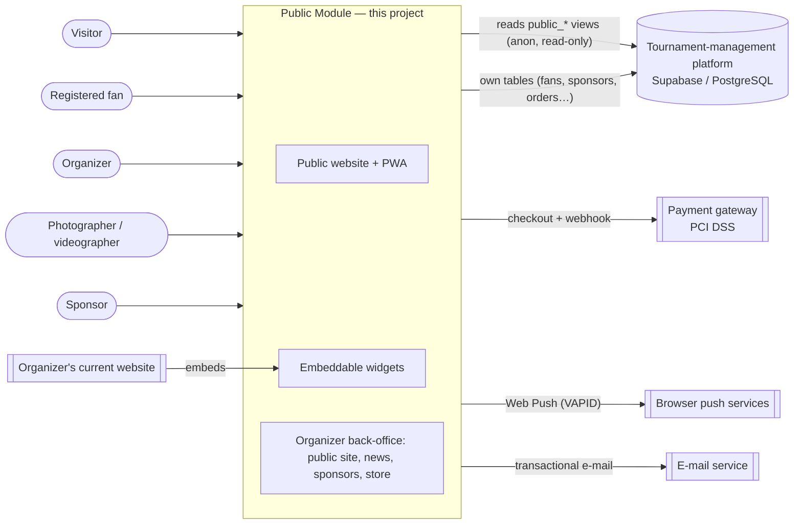

# 1. System domain

## 1.1 System context

The project extends an existing **tournament-management platform** for youth football (registration, player ID cards, treasury, groups and fixtures, match scheduling, referees, results and standings). That platform is already in production with a real organizer, **DBS Complejo Deportivo**, and stores everything in PostgreSQL (Supabase) with row-level security (RLS) per organization.

This semester the team builds the **Public Module**: the tournament's public website, embeddable widgets and installable app (PWA), plus its commercial features. The Public Module **does not manage the tournament**. It **reads** what the management platform has already approved and published, and it **owns** a new set of data: fan accounts, followed teams, news and galleries, sponsors, the store, photo/video bookings and team pre-registrations.

**Boundary rules of the context**

| Inside the Public Module | Outside (consumed, never modified) |
|---|---|
| Public pages, PWA, widgets, fan accounts, follows, notifications to fans, news, galleries, sponsor placements and metrics, store, orders, photo/video bookings, pre-registrations, public-site branding | Tournaments, categories, clubs, teams, groups, matches, goals, standings, documents, venues and fields (owned by the management platform) |

## 1.2 Actor characterization

| Actor | Type | Description | Main goals in the Public Module | Access |
|---|---|---|---|---|
| **Visitor** | Primary, human | Parents, relatives, players and the general public. Mostly on a phone, often at the venue on match day. | Check the schedule, results, standings, top scorers, team and club pages, news and public documents; install the app. | Anonymous, read-only. |
| **Registered fan** | Primary, human (specializes Visitor) | A visitor who creates an account with e-mail or Google. | Follow teams, see "my teams" first, receive push notifications, buy in the store, book photo/video packages. | Fan account; only their own data (RLS). It never grants access to the delegate or organizer panels. |
| **Organizer** | Primary, human | Staff of the organization (e.g., DBS) who already uses the management platform. | Brand the public site, choose what is published, post news and galleries, generate widgets, manage sponsors, products, orders, bookings and pre-registrations. | Organization member; scoped to their organization. |
| **Photographer / videographer** | Primary, human | Contractor of the organization who covers matches. | See the matches assigned to them and upload the delivery link of each booking. | Own account; only their assignments. |
| **Sponsor** | Primary, human | Brand that pays for placements on the site, app and matchday graphics. | Check and download the metrics of their own placements. | Own account; only their placements. |
| **Tournament-management platform** | Secondary, system | Existing system and single source of truth of the competition. | Publishes approved schedule, results, standings and documents through `public_*` views. | Database views; anon role only sees tournaments marked `public`. |
| **Payment gateway** | Secondary, system | PCI DSS certified provider (e.g., ePayco, already integrated in the platform). | Charge store orders and bookings; confirm through a webhook. | Server-to-server, signed webhook. |
| **Push service** | Secondary, system | Browser push services (FCM, Apple Push, Mozilla). | Deliver notifications to fans' devices. | Web Push with VAPID keys. |
| **E-mail service** | Secondary, system | Transactional e-mail provider. | Order confirmations and delivery links. | API key, server side. |

## 1.3 Business rules

| ID | Business rule | Source |
|---|---|---|
| BR-01 | Only tournaments marked as **public** by their organization are visible in the Public Module; everything else returns no rows. | RF-14, management platform design |
| BR-02 | A match is shown on the public schedule only after the organization **approves** the matchday schedule; until then it appears as **"To be scheduled"**, without field or time. | RF-01, HU-01 |
| BR-03 | A reported result that the organization has not approved yet is shown and counted in the standings as **"Provisional"**; it becomes **"Final"** only after approval against the paper match sheet. | RF-02, HU-02 |
| BR-04 | Standings award 3 points per win, 1 per draw and 0 per loss, and break ties by goal difference, then goals for, then wins. Withdrawn teams go to the bottom, marked **"Withdrawn"**, and all their matches count as 0–3 walkovers. | RF-03, tournament rules |
| BR-05 | Top scorers and best defense accumulate over the whole tournament for each category. Goals from annulled matches do not count. | RF-04 |
| BR-06 | The public view **never exposes** players' ID numbers, birth dates, ID-card photos, contact data or balances. A player is shown only by name, team and goals (Colombian Law 1581 of 2012; most players are minors). | RNF-04 |
| BR-07 | Only documents explicitly marked as **public** are listed; documents addressed to delegates or referees never appear. | RF-05, HU-05 |
| BR-08 | A fan account only grants access to the fan's own data (follows, notifications, orders, bookings). It never grants access to delegate, referee or organizer panels. | RF-16, RNF-05 |
| BR-09 | A fan receives a push notification only for teams they follow, and only when that team's schedule is published or its result is approved. | RF-18 |
| BR-10 | An order or booking is **confirmed only when the payment gateway approves the payment**. Each gateway transaction is applied **once**, even if the webhook arrives several times (idempotency). The system never stores card data. | RF-23, RNF-06 |
| BR-11 | A product variant cannot be sold beyond its stock; stock is reserved when the payment is approved. | RF-22, RF-23 |
| BR-12 | A photo/video booking is allowed only for a **scheduled** match and only up to the booking cut-off set by the organizer; a photographer is assigned per match, not per booking. | RF-25, RF-26 |
| BR-13 | The customer is notified (e-mail + push) as soon as the photographer uploads the delivery link; the link is visible only to the customer who paid. | RF-27 |
| BR-14 | A sponsor placement is shown only between its start and end dates, and sponsors only see the metrics of their own placements. Impressions and clicks are recorded **without personal data** of the visitor. | RF-19, RF-20, RF-21 |
| BR-15 | Each organization has its own brand (logo, colors, domain) and its data never mixes with another organization's (multi-tenant isolation by RLS, not by hostname). | RF-13, RNF-11 |
| BR-16 | A pre-registration does not create a team in the tournament; the organizer must approve it, and only then is the club invited to the regular registration flow of the management platform. | RF-28 |
