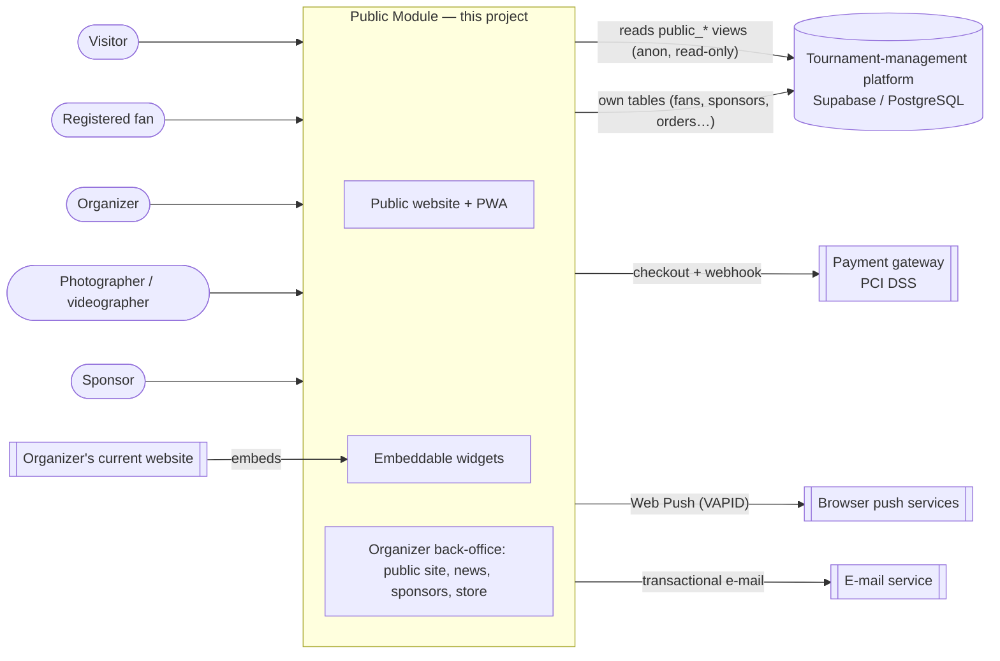

# 1. System domain

## 1.1 System context

**Nature of the system.** The Public Module is a web application and PWA administered by tournament organizers, so that players and their guardians can follow the tournament, photographers and videographers can fulfill photo and video bookings, and sponsors, which are allied brands that pay for advertising, can check its results. It is an information system with an e-commerce component: most of its use is reading public tournament data, and a smaller part is commercial (store, photo and video bookings, sponsorship). It is multi-tenant, so each organization has its own brand and isolated data. The pilot organization is **DBS Complejo Deportivo**, in Bogotá, Colombia.

The project extends an existing **tournament-management platform** for youth football (registration, player ID cards, treasury, groups and fixtures, match scheduling, referees, results and standings). That platform is already in production with a real organizer, DBS, and stores everything in PostgreSQL (Supabase) with row-level security (RLS) per organization.

This semester the team builds the **Public Module**: the tournament's public website, embeddable widgets and installable app (PWA), plus its commercial features. The Public Module **does not manage the tournament**. It **reads** what the management platform has already approved and published, and it **owns** a new set of data: fan accounts, followed teams, news and galleries, sponsors, the store, photo/video bookings and team pre-registrations.

**Boundary rules of the context**

| Inside the Public Module | Outside (consumed, never modified) |
|---|---|
| Public pages, PWA, widgets, fan accounts, follows, notifications to fans, news, galleries, sponsor placements and metrics, store, orders, photo/video packages, their capacity per matchday and their bookings, pre-registrations, public-site branding | Tournaments, categories, clubs, teams, groups, matchdays, matches, goals, standings, documents, venues and fields (owned by the management platform) |

The Public Module **does not book fields or venues**. Its only bookings are photo and video packages (BR-17). Venues and fields appear only to say where each match is played.

## 1.2 Actor characterization

**Human actors.** Ages are estimates to be validated with the pilot organization, and the location is that of the pilot.

| Actor | Type | Description | Age range | Geographic location | Main goals in the Public Module |
|---|---|---|---|---|---|
| **Visitor** | Primary | Players and their guardians, plus relatives and the general public. Mostly on a phone. | Players: 6 to 18 years. Guardians and relatives: adults. | Bogotá, mostly at the venue on match day. | Check the schedule, results, standings, top scorers, team and club pages, news and public documents; install the app. |
| **Registered fan** | Primary (specializes Visitor) | A visitor with an account, created with e-mail or Google. Usually the player's guardian (BR-23). | Adult (18+). | Bogotá. | Follow teams, see "my teams" first, receive push notifications, buy in the store, book photo/video packages. |
| **Organizer** | Primary | Staff of the organization (e.g., DBS) who administers the public site and already uses the management platform. | Adult (18+). | Bogotá. | Brand the public site, choose what is published, post news and galleries, generate widgets, manage sponsors, products, orders, packages, bookings and pre-registrations. |
| **Photographer / videographer** | Primary | Contractor of the organization who fulfills the photo and video bookings. | Adult (18+). | DBS venues in Bogotá. | See the matches assigned to them and upload the delivery link of each booking. |
| **Sponsor** | Primary | Allied brand that pays for advertising on the site, app and matchday graphics. It uses the system through a representative. | Representative: adult (18+). | Bogotá (assumption). | Check and download the metrics of their own placements. |

**System actors**

| Actor | Type | Description | Role in the Public Module | Access |
|---|---|---|---|---|
| **Tournament-management platform** | Secondary | Existing system and single source of truth of the competition. | Publishes approved schedule, results, standings and documents through `public_*` views. | Database views; anon role only sees tournaments marked `public`. |
| **Payment gateway** | Secondary | PCI DSS certified provider (e.g., ePayco, already integrated in the platform). | Charge store orders and bookings; confirm through a webhook. | Server-to-server, signed webhook. |
| **Push service** | Secondary | Browser push services (FCM, Apple Push, Mozilla). | Deliver notifications to fans' devices. | Web Push with VAPID keys. |
| **E-mail service** | Secondary | Transactional e-mail provider. | Order confirmations and delivery links. | API key, server side. |

**Permissions by actor.** Legend: **R** read; **Yes** allowed; **Own** only their own data; **Org** everything in their organization; — no access. The database enforces these permissions through RLS (section 4.4), not only the interface.

| Capability | Visitor | Registered fan | Organizer | Photographer / videographer | Sponsor |
|---|---|---|---|---|---|
| Read schedule, results, standings, teams, clubs, news, venues and public documents | R | R | R | R | R |
| Follow teams and receive notifications | — | Own | — | — | — |
| Buy in the store and book photo/video packages | — | Own | — | — | — |
| See orders and bookings | — | Own | Org | Own (assigned matches) | — |
| Download the delivery link of a booking | — | Own (paid booking) | — | — | — |
| Upload the delivery link of a booking | — | — | — | Own (assigned matches) | — |
| Brand the site, choose what is published, post news and galleries, generate widgets | — | — | Org | — | — |
| Manage products, packages, capacity per matchday and photographer assignments | — | — | Org | — | — |
| Manage sponsors and their placements | — | — | Org | — | — |
| See placement metrics | — | — | Org | — | Own |
| Send a team pre-registration | Yes (public form) | Yes (public form) | — | — | — |
| Approve or reject pre-registrations | — | — | Org | — | — |
| Delegate and referee panels, and players' personal data | — | — | — | — | — |

## 1.3 Business rules

Each rule states its source requirement and the classes (section 3) and tables or views (section 4) that implement it.

| ID | Business rule | Source | Implemented by |
|---|---|---|---|
| BR-01 | Only tournaments marked as **public** by their organization are visible in the Public Module; everything else returns no rows. | RF-14, management platform design | `Tournament`, `PublishedTournament`; `public_*` views, `pm_published_tournaments` |
| BR-02 | A match is shown on the public schedule only after the organization **approves** the matchday schedule; until then it appears as **"To be scheduled"**, without field or time. | RF-01, HU-01 | `Match.publicStatus()`; `public_schedule` |
| BR-03 | A reported result that the organization has not approved yet is shown and counted in the standings as **"Provisional"**; it becomes **"Final"** only after approval against the paper match sheet. | RF-02, HU-02 | `Match`, `Standing`; `public_schedule`, `public_standings` |
| BR-04 | Standings award 3 points per win, 1 per draw and 0 per loss, and break ties by goal difference, then goals for, then wins. Withdrawn teams go to the bottom, marked **"Withdrawn"**, and all their matches count as 0–3 walkovers. | RF-03, tournament rules | `Standing`, `Team`; `public_standings` |
| BR-05 | Top scorers and best defense accumulate over the whole tournament for each category. Goals from annulled matches do not count. | RF-04 | `Goal`; `public_top_scorers`, `public_best_defense` |
| BR-06 | The public view **never exposes** players' ID numbers, birth dates, ID-card photos, contact data or balances. A player is shown only by name, team and goals (Colombian Law 1581 of 2012; most players are minors). | RNF-04 | `Goal`; `public_match_scorers` |
| BR-07 | Only documents explicitly marked as **public** are listed; documents addressed to delegates or referees never appear. | RF-05, HU-05 | `Document`; `public_documents` |
| BR-08 | A fan account only grants access to the fan's own data (follows, notifications, orders, bookings). It never grants access to delegate, referee or organizer panels. | RF-16, RNF-05 | `User`, `FanAccount`; `pm_accounts`, RLS |
| BR-09 | A fan receives a push notification only for teams they follow, and only when that team's schedule is published or its result is approved. | RF-18 | `TeamFollow`, `Notification`, `PushSubscription`; `pm_team_follows`, `pm_notifications` |
| BR-10 | An order or booking is **confirmed only when the payment gateway approves the payment**. Each gateway transaction is applied **once**, even if the webhook arrives several times (idempotency). The system never stores card data. | RF-23, RNF-06 | `Payment`, `PaymentGateway`; `pm_payments` (UK `gateway_ref`) |
| BR-11 | A product variant cannot be sold beyond its stock; stock is decremented when the payment is approved. Sizes and stock apply **only to store merchandise**: photo and video packages have neither (see BR-19). | RF-22, RF-23 | `Product`, `ProductVariant`, `OrderItem`; `pm_product_variants` |
| BR-12 | A photo/video booking is allowed only for a **scheduled** match and only up to the booking cut-off, the number of hours before kickoff that the organizer sets for each package. A photographer is assigned per match, not per booking. | RF-25, RF-26 | `Match.isBookable()`, `MediaPackage`, `PhotographerAssignment`; `pm_media_bookings` (trigger), `pm_photographer_assignments` |
| BR-13 | The customer is notified (e-mail + push) as soon as the photographer uploads the delivery link; the link is visible only to the customer who paid. | RF-27 | `MediaBooking.deliver()`, `Notification`; `pm_media_bookings`, `pm_notifications` |
| BR-14 | A sponsor placement is shown only between its start and end dates, and sponsors only see the metrics of their own placements. Impressions and clicks are recorded **without personal data** of the visitor. Sponsors pay the organizer directly under their own agreement, outside the platform: no `Payment` is created for a placement. | RF-19, RF-20, RF-21 | `Sponsor`, `SponsorPlacement`, `PlacementEvent`; `pm_sponsors`, `pm_sponsor_placements`, `pm_placement_events` |
| BR-15 | Each organization has its own brand (logo, colors, domain) and its data never mixes with another organization's (multi-tenant isolation by RLS, not by hostname). | RF-13, RNF-11 | `Organization`, `PublicSite`; `pm_public_sites`, RLS |
| BR-16 | A pre-registration does not create a team in the tournament; the organizer must approve it, and only then is the club invited to the regular registration flow of the management platform. | RF-28 | `PreRegistration`; `pm_pre_registrations` |
| BR-17 | A **booking** is the advance purchase of one photo or video package for one match. It never books a field, a venue or a time slot. | RF-25, HU-16 | `MediaBooking`, `MediaPackage`; `pm_media_bookings` |
| BR-18 | The organizer defines the packages: name, type (photo or video), price, booking cut-off and active flag. A fan can only choose an active package. The booking stores the price at purchase, so a later price change does not affect it. | RF-25, HU-29 | `MediaPackage`, `MediaBooking.unitPrice`; `pm_media_packages`, `pm_media_bookings` |
| BR-19 | A package can be booked only for the matchdays where the organizer opened it, and up to the **capacity** set for that matchday (for example, 10 video packages per matchday). Paid bookings and pending bookings that have not expired take a slot. When there are no slots left, the booking is refused. | RF-25, HU-29 (capacity added in design review) | `MediaAvailability`, `Matchday`; `pm_media_availability`, `pm_media_bookings` (trigger) |
| BR-20 | A booking starts as **pending** and becomes **paid** when the payment is approved, then **delivered** when the link is uploaded. A pending or paid booking can be **cancelled**. A pending booking that is not paid before it expires is cancelled and releases its slot. | RF-25, RF-27, HU-16, HU-17 | `MediaBooking`; `pm_media_bookings` (`status`, `expires_at`) |
| BR-21 | Each payment belongs to **exactly one** order or one booking, for its full amount. A rejected payment confirms nothing and does not change stock or slots already taken; the customer can retry with a new payment. | RF-23, RNF-06, HU-15 | `Payment`, `Order`, `MediaBooking`; `pm_payments` (CHECK) |
| BR-22 | A match that was already played or cancelled cannot be booked. If a match with bookings is rescheduled, the bookings follow the new date, and the customers and the photographer are notified. If a booked match will not be played, the organizer refunds the customer outside the platform and the booking is cancelled. | HU-16, HU-29 | `Match.isBookable()`, `MediaBooking`, `Notification`; `pm_media_bookings`, `pm_notifications` |
| BR-23 | Fan accounts belong to **adults**, normally the player's guardian. A minor player uses the site without an account or through their guardian's account, so the Public Module collects no personal data from minors. | RNF-04, HU-16, Colombian Law 1581 of 2012 | `FanAccount.adultConfirmedAt`; `pm_accounts` |
