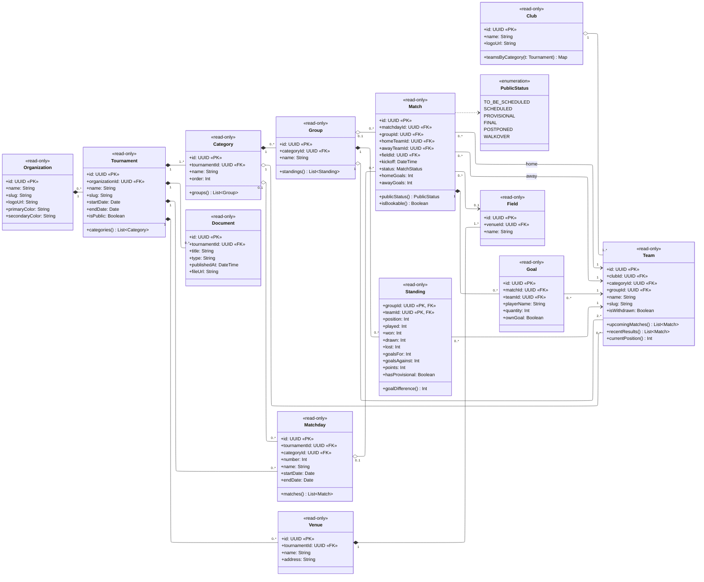
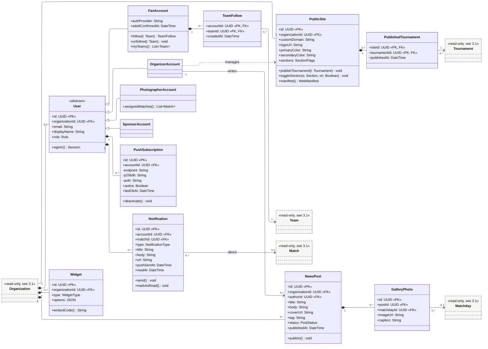
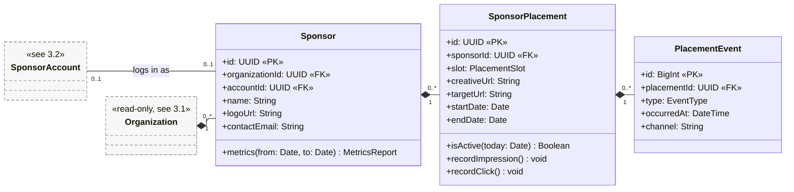
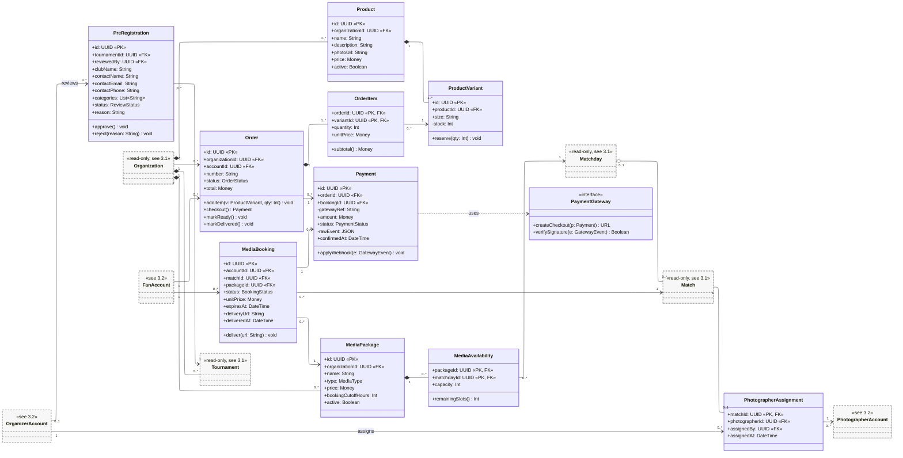

# 3. Class diagram

UML class diagram of the Public Module, split into three views so it stays readable. The complete diagram, with every class together, is in the annex (section 3.5).

How to read it:

- Classes with the `«read-only»` stereotype are projections of the tournament-management platform (through the `public_*` views). Every other class is owned by this module.
- Classes with a **dashed border** are defined in another view and are repeated only to show how this view connects to the rest. Their stereotype says which view that is.
- `«PK»` marks the primary key and `«FK»` a foreign key, so every relationship can be traced to its column in section 4.
- Visibility: `+` public, `-` private.

## 3.1 Competition (read-only projection)

## 3.2 Public site, fans and content

## 3.3 Sponsorship and commerce

### a) Sponsorship

### b) Store, photo/video bookings, payments and pre-registrations

## 3.4 Design notes

- **Read-only projection.** Competition classes have no mutating methods in this module: the management platform owns them (Domain-Driven Design *bounded context*). The Public Module talks to them only through views, which keeps the dependency one-way.
- **Two catalogues, because they sell different things.** `Product` and `ProductVariant` are the store: physical merchandise such as a jersey, which has sizes and a stock per size (RF-22). `MediaPackage` holds the photo and video plans a fan can choose, with their price (RF-25). These plans have no size, and their limit is not a stock: it depends on the matchday, so it lives in `MediaAvailability`.
- **Capacity per matchday.** `MediaAvailability` is the association between a `MediaPackage` and a `Matchday`, and holds how many bookings that package accepts on that matchday (BR-19). A `MediaBooking` points to a `Match`, and the match gives the matchday. That is the path used to count the slots taken.
- **Fields are not booked.** `Venue` and `Field` stay in the model because each match must say where it is played (RF-01, HU-31). No class books them (BR-17).
- **Dependency inversion.** `Payment` depends on the `PaymentGateway` interface, not on a concrete provider, so the gateway can change without touching orders or bookings (SOLID: DIP and OCP).
- **Single responsibility.** `Notification` only builds and delivers messages; deciding *who* gets them belongs to `TeamFollow`; computing standings stays in the platform's `Standing` view.
- **Roles by specialization.** `FanAccount`, `OrganizerAccount`, `PhotographerAccount` and `SponsorAccount` specialize `User`. In the database this becomes one `pm_accounts` table linked to the authentication provider (`auth.users`) with a `role` column (see section 4).

## 3.5 Annex: complete class diagram

The three views above are one model, split only for reasons of space. The annex shows every class and relationship together:

- [annex/Workshop-2-class-diagram-annex.pdf](annex/Workshop-2-class-diagram-annex.pdf): the complete diagram on a single large page.
- [annex/class-diagram-full.drawio.xml](annex/class-diagram-full.drawio.xml): the same diagram as an editable XML file, which opens in [diagrams.net](https://app.diagrams.net/).
