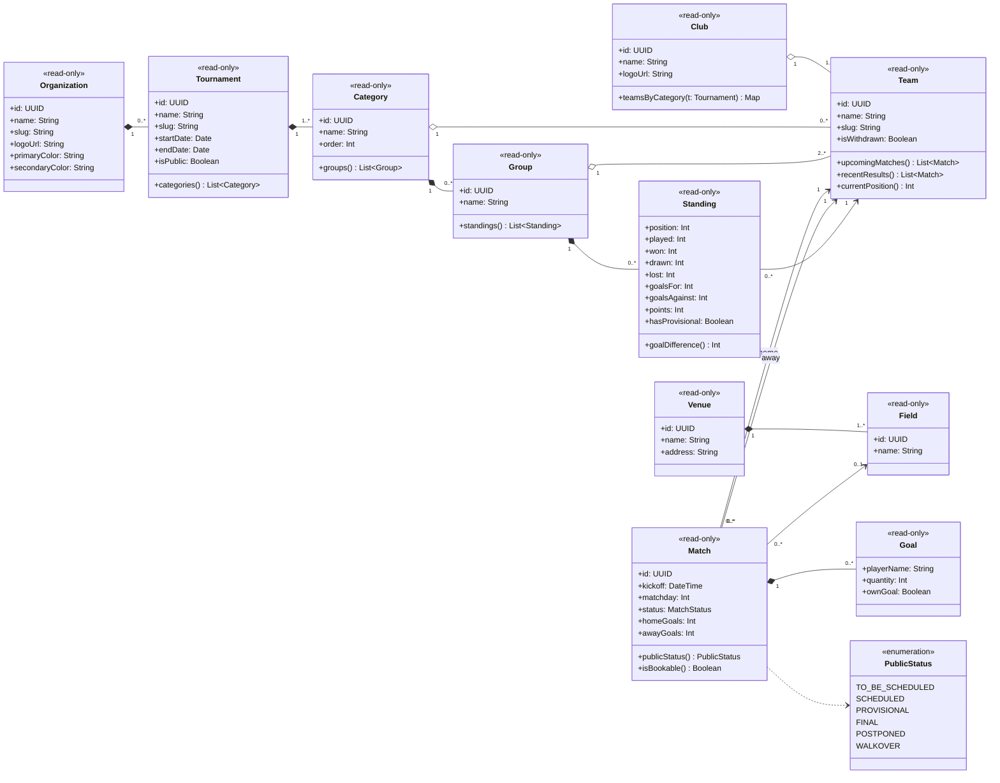
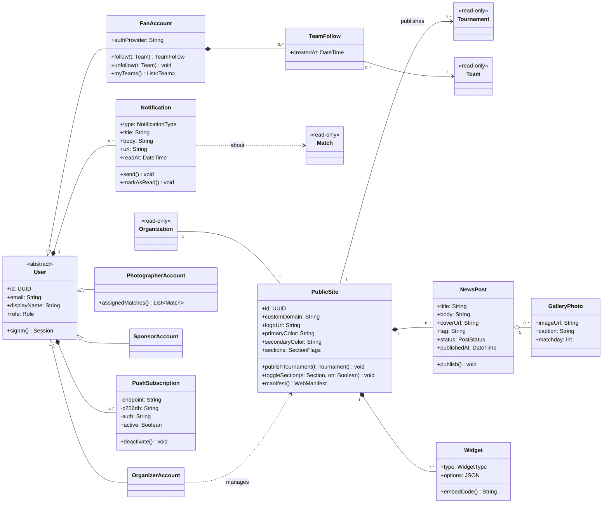
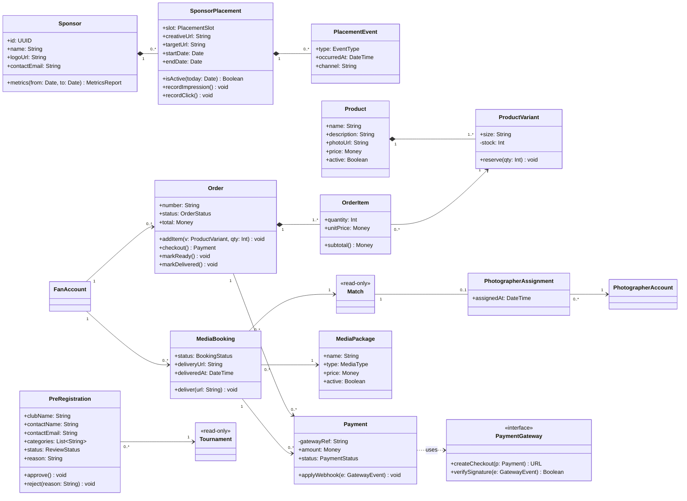

# 3. Class diagram

UML class diagram of the Public Module, split into three views so it stays readable. Classes with the `«read-only»` stereotype are projections of the tournament-management platform (through the `public_*` views). Every other class is owned by this module. Visibility: `+` public, `-` private.

## 3.1 Competition (read-only projection)

## 3.2 Public site, fans and content

## 3.3 Sponsorship and commerce

## 3.4 Design notes

- **Read-only projection.** Competition classes have no mutating methods in this module: the management platform owns them (Domain-Driven Design *bounded context*). The Public Module talks to them only through views, which keeps the dependency one-way.
- **Dependency inversion.** `Payment` depends on the `PaymentGateway` interface, not on a concrete provider, so the gateway can change without touching orders or bookings (SOLID: DIP and OCP).
- **Single responsibility.** `Notification` only builds and delivers messages; deciding *who* gets them belongs to `TeamFollow`; computing standings stays in the platform's `Standing` view.
- **Roles by specialization.** `FanAccount`, `OrganizerAccount`, `PhotographerAccount` and `SponsorAccount` specialize `User`. In the database this becomes one `pm_accounts` table linked to the authentication provider (`auth.users`) with a `role` column (see section 4).
