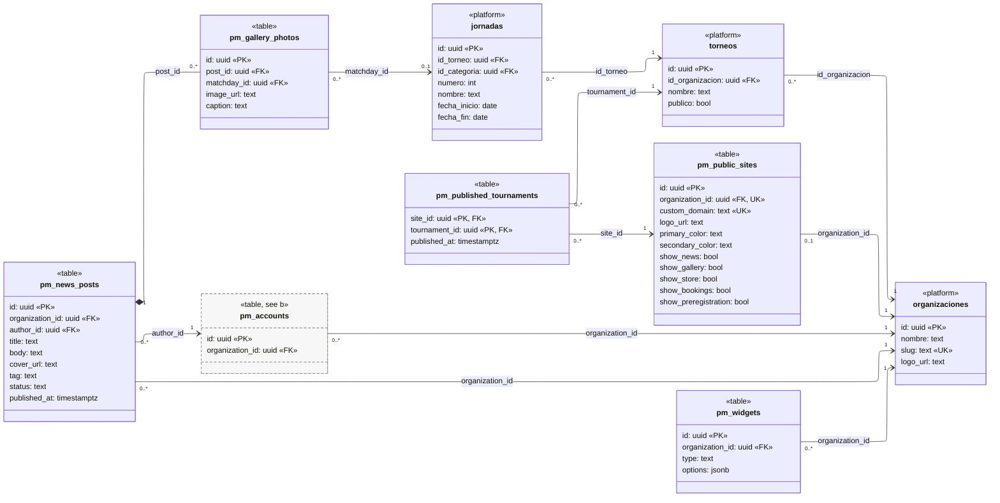
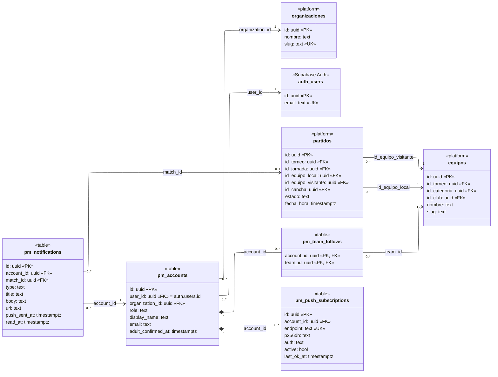
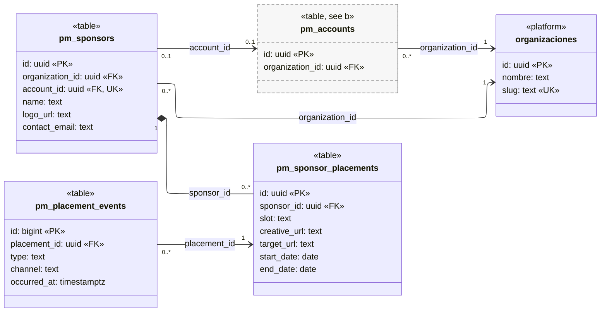
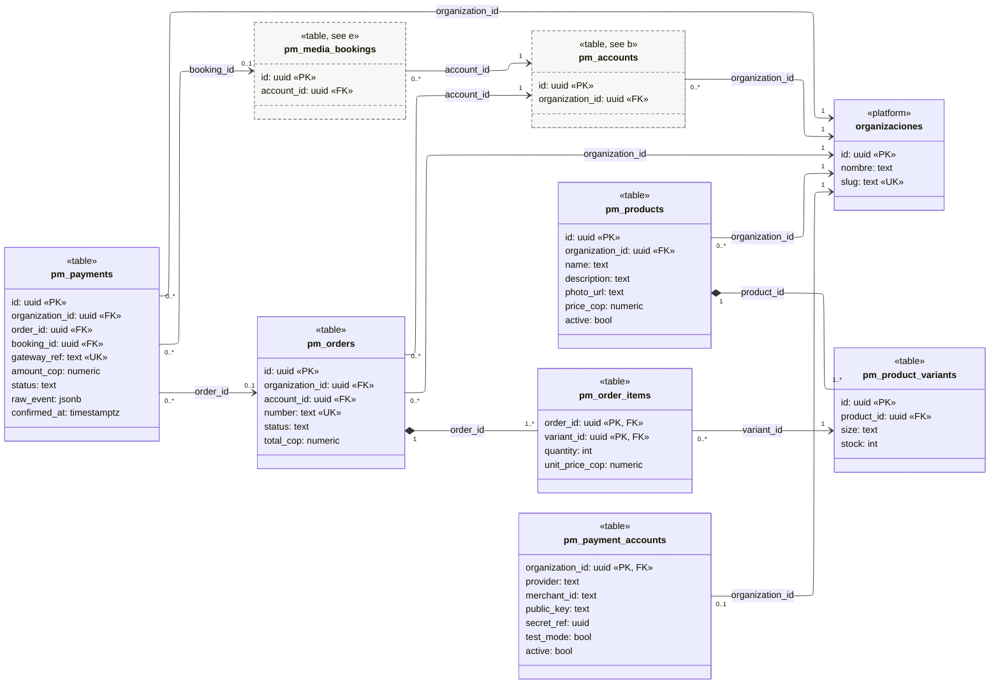
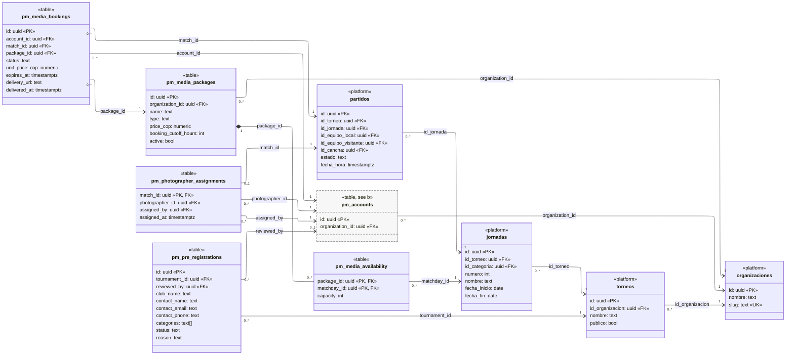

# 4. Relational database model

**Engine:** PostgreSQL (Supabase), the same database as the tournament-management platform.

The model has two parts:

1. **Consumed (read-only).** These are the existing platform tables (`organizaciones`, `torneos`, `categorias`, `clubes`, `equipos`, `jornadas`, `partidos`, `partido_goles`…). The anonymous role never reads them directly. It reads `public_*` views, which return rows only for tournaments with `torneos.publico = true` and expose no personal data (BR-01, BR-06).
2. **Owned.** These are new tables with the `pm_` prefix (Public Module), created through versioned SQL migrations. Every table is anchored to an organization, directly through `organization_id` or through its parent table, and row-level security (RLS) policies isolate organizations and owners (BR-08, BR-15).

## 4.1 Database diagrams in UML notation

The schema is split into five diagrams for readability, following the groups of section 4.3. All of them are connected through `organizaciones`.

How to read them:

- Each box is a table, with all its columns. `«table»` marks an owned table and `«platform»` an existing table of the management platform, kept with its name in production and showing only the columns this module uses.
- `«PK»` marks the primary key, `«FK»` a foreign key and `«UK»` a unique column.
- Each line is a foreign key, labelled with its column and with the multiplicity at each end. A plain arrow goes from the table that holds the key to the table it references. A filled diamond is a composition: the child rows are deleted with their parent (`ON DELETE CASCADE`).
- A **dashed border** marks an owned table whose columns are in another diagram; it shows only the keys used here.

### a) Public site and content

### b) Accounts, follows and notifications

### c) Sponsorship

### d) Store and payments

### e) Photo/video bookings and pre-registrations

## 4.2 Consumed views (read-only, role `anon`)

| View | Columns exposed | Source tables | Filter |
|---|---|---|---|
| `public_schedule` | match_id, tournament_id, category, group, matchday_id, matchday, kickoff, venue, field, home_team, away_team, home_goals, away_goals, public_status | `partidos`, `equipos`, `canchas`, `sedes`, `jornadas` | tournament is public; schedule approved, otherwise `public_status = 'TO_BE_SCHEDULED'` and no field or time |
| `public_match_scorers` | match_id, team_id, player_name, goals | `partido_goles`, `inscripciones`, `participantes` | only the player's name: no ID number, birth date or photo |
| `public_standings` | tournament_id, category, group, team_id, team, position, played, won, drawn, lost, gf, ga, gd, points, has_provisional, withdrawn | view `posiciones` | tournament is public |
| `public_top_scorers` | tournament_id, category, player_name, team, goals, position | view `goleadores` | tournament is public |
| `public_best_defense` | tournament_id, category, team, played, goals_against, position | view `valla_menos_vencida` | tournament is public |
| `public_teams` / `public_clubs` | id, name, slug, logo_url, category, group, club | `equipos`, `clubes`, `grupo_equipos` | tournament is public |
| `public_documents` | id, title, type, published_at, file_url | `documentos_torneo` | document marked public (new flag, BR-07) |

## 4.3 Owned tables

Notation: **PK** primary key, **FK** foreign key, **UK** unique. Every table also has `created_at timestamptz DEFAULT now()`.

### Public site and content

| Table | Columns | Keys and constraints |
|---|---|---|
| `pm_public_sites` | id uuid, organization_id uuid, custom_domain text, domain_verified_at timestamptz, logo_url text, primary_color text, secondary_color text, show_news bool, show_gallery bool, show_store bool, show_bookings bool, show_preregistration bool | PK id · FK organization_id → organizaciones(id) · UK organization_id · UK custom_domain · `logo_url`, `primary_color` and `secondary_color` are optional overrides: when null, the brand in `organizaciones` applies (BR-15) |
| `pm_published_tournaments` | site_id uuid, tournament_id uuid, published_at timestamptz | PK (site_id, tournament_id) · FK site_id → pm_public_sites · FK tournament_id → torneos(id) |
| `pm_news_posts` | id uuid, organization_id uuid, title text, body text, cover_url text, tag text, status text, published_at timestamptz, author_id uuid | PK id · FK organization_id → organizaciones · FK author_id → pm_accounts · CHECK status IN ('draft','published') |
| `pm_gallery_photos` | id uuid, post_id uuid, matchday_id uuid, image_url text, caption text | PK id · FK post_id → pm_news_posts ON DELETE CASCADE · FK matchday_id → jornadas(id) (nullable) |
| `pm_widgets` | id uuid, organization_id uuid, type text, options jsonb | PK id · FK organization_id → organizaciones · CHECK type IN ('standings','upcoming','results') |

### Accounts, follows and notifications

| Table | Columns | Keys and constraints |
|---|---|---|
| `pm_accounts` | id uuid, user_id uuid, organization_id uuid, role text, display_name text, email text, adult_confirmed_at timestamptz | PK id · FK user_id → auth.users · FK organization_id → organizaciones · UK (user_id, organization_id, role) (BR-25) · CHECK role IN ('fan','organizer','photographer','sponsor') · UK (organization_id, email) · CHECK adult_confirmed_at IS NOT NULL when role = 'fan' (BR-23) |
| `pm_team_follows` | account_id uuid, team_id uuid | PK (account_id, team_id) · FK account_id → pm_accounts ON DELETE CASCADE · FK team_id → equipos(id) |
| `pm_push_subscriptions` | id uuid, account_id uuid, endpoint text, p256dh text, auth text, active bool, last_ok_at timestamptz | PK id · FK account_id → pm_accounts ON DELETE CASCADE · UK endpoint |
| `pm_notifications` | id uuid, account_id uuid, match_id uuid, type text, title text, body text, url text, push_sent_at timestamptz, read_at timestamptz | PK id · FK account_id → pm_accounts · FK match_id → partidos(id) (nullable) · CHECK type IN ('schedule_published','result_approved','delivery_ready','match_rescheduled') |

### Sponsorship

| Table | Columns | Keys and constraints |
|---|---|---|
| `pm_sponsors` | id uuid, organization_id uuid, account_id uuid, name text, logo_url text, contact_email text | PK id · FK organization_id → organizaciones · FK account_id → pm_accounts (nullable) · UK account_id |
| `pm_sponsor_placements` | id uuid, sponsor_id uuid, slot text, creative_url text, target_url text, start_date date, end_date date | PK id · FK sponsor_id → pm_sponsors ON DELETE CASCADE · CHECK slot IN ('web_banner','app_banner','matchday_graphic') · CHECK end_date >= start_date |
| `pm_placement_events` | id bigint, placement_id uuid, type text, channel text, occurred_at timestamptz | PK id · FK placement_id → pm_sponsor_placements · CHECK type IN ('impression','click') · no personal data columns (BR-14) |

### Store and payments

| Table | Columns | Keys and constraints |
|---|---|---|
| `pm_products` | id uuid, organization_id uuid, name text, description text, photo_url text, price_cop numeric(12,0), active bool | PK id · FK organization_id → organizaciones · CHECK price_cop > 0 |
| `pm_product_variants` | id uuid, product_id uuid, size text, stock int | PK id · FK product_id → pm_products ON DELETE CASCADE · UK (product_id, size) · CHECK stock >= 0 (BR-11) |
| `pm_orders` | id uuid, organization_id uuid, account_id uuid, number text, status text, total_cop numeric(12,0) | PK id · FK organization_id → organizaciones · FK account_id → pm_accounts · UK number · CHECK status IN ('pending','paid','ready','delivered','cancelled') |
| `pm_order_items` | order_id uuid, variant_id uuid, quantity int, unit_price_cop numeric(12,0) | PK (order_id, variant_id) · FK order_id → pm_orders ON DELETE CASCADE · FK variant_id → pm_product_variants · CHECK quantity > 0 |
| `pm_payment_accounts` | organization_id uuid, provider text, merchant_id text, public_key text, secret_ref uuid, test_mode bool, active bool | PK organization_id · FK organization_id → organizaciones · CHECK provider IN ('epayco') · `secret_ref` points to the secret key stored encrypted in Supabase Vault, readable only by the server (BR-24) |
| `pm_payments` | id uuid, organization_id uuid, order_id uuid, booking_id uuid, gateway_ref text, amount_cop numeric(12,0), status text, raw_event jsonb, confirmed_at timestamptz | PK id · FK organization_id → organizaciones · FK order_id → pm_orders · FK booking_id → pm_media_bookings · **UK (organization_id, gateway_ref)** (idempotent webhook, BR-10) · CHECK exactly one of order_id / booking_id is not null (BR-21) · CHECK status IN ('pending','approved','rejected') |

### Photo/video bookings and pre-registrations

| Table | Columns | Keys and constraints |
|---|---|---|
| `pm_media_packages` | id uuid, organization_id uuid, name text, type text, price_cop numeric(12,0), booking_cutoff_hours int, active bool | PK id · FK organization_id → organizaciones · CHECK type IN ('photo','video') · CHECK price_cop > 0 |
| `pm_media_availability` | package_id uuid, matchday_id uuid, capacity int | PK (package_id, matchday_id) · FK package_id → pm_media_packages ON DELETE CASCADE · FK matchday_id → jornadas(id) · CHECK capacity > 0 (BR-19) |
| `pm_media_bookings` | id uuid, account_id uuid, match_id uuid, package_id uuid, status text, unit_price_cop numeric(12,0), expires_at timestamptz, delivery_url text, delivered_at timestamptz | PK id · FK account_id → pm_accounts · FK match_id → partidos(id) · FK package_id → pm_media_packages · CHECK status IN ('pending','paid','delivered','cancelled') (BR-20) · trigger: the match must be scheduled and before the cut-off (BR-12), and its matchday must have slots left (BR-19) |
| `pm_photographer_assignments` | match_id uuid, photographer_id uuid, assigned_by uuid, assigned_at timestamptz | PK match_id · FK match_id → partidos(id) · FK photographer_id → pm_accounts (role = photographer) · FK assigned_by → pm_accounts (role = organizer) |
| `pm_pre_registrations` | id uuid, tournament_id uuid, reviewed_by uuid, club_name text, contact_name text, contact_email text, contact_phone text, categories text[], status text, reason text | PK id · FK tournament_id → torneos(id) · FK reviewed_by → pm_accounts (nullable) · CHECK status IN ('pending','approved','rejected') · CHECK reason IS NOT NULL when rejected |

## 4.4 Integrity and security rules in the database

- **RLS on every `pm_` table.** A fan reads and writes only rows of their own account in that organization (`pm_accounts.user_id = auth.uid()` and the row's organization). An organizer reads and writes only rows of organizations where they are a member (the existing `es_miembro_org()` helper). A sponsor reads only their own placements and events. The anonymous role reads only published news, active placements, active products and the `public_*` views.
- **Multi-organization (white-label).** Every policy is scoped to one organization, as in the management platform: the row's `organization_id`, or its parent's, must be an organization where the user has an account or a membership. The organization resolved from the domain only chooses what the site shows; it never grants access. The anonymous role reads public data of any organization, and the site filters it by the organization of the domain.
- **One identity, one account per organization.** `pm_accounts` has `UK (user_id, organization_id, role)`, so a person who follows teams in two leagues has two accounts with the same sign-in, and neither league sees the other's data (BR-25).
- **Idempotent payments.** The `UK (organization_id, gateway_ref)` constraint plus `INSERT … ON CONFLICT DO NOTHING` guarantee that repeated webhooks confirm a payment once.
- **Stock.** It is decremented in the same transaction that marks the payment as approved; `CHECK stock >= 0` aborts overselling.
- **Capacity per matchday.** The trigger on `pm_media_bookings` locks the matching row of `pm_media_availability` (`SELECT … FOR UPDATE`) and counts the paid bookings and the pending ones that have not expired, so two fans cannot take the last slot at the same time (BR-19). A pending booking stops counting when `expires_at` passes, and a scheduled job then marks it as cancelled (BR-20).
- **No personal data in public views.** The views select explicit columns (never `*`) and run with `security_invoker` to keep the platform's RLS in force.
