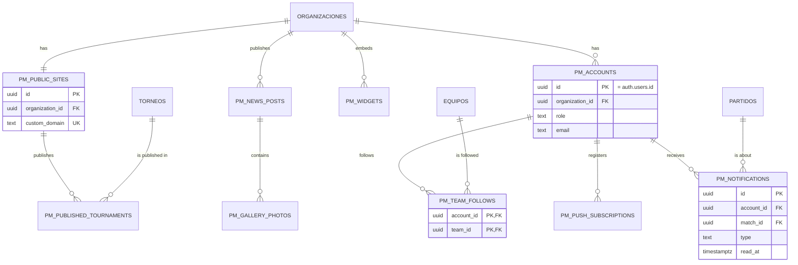
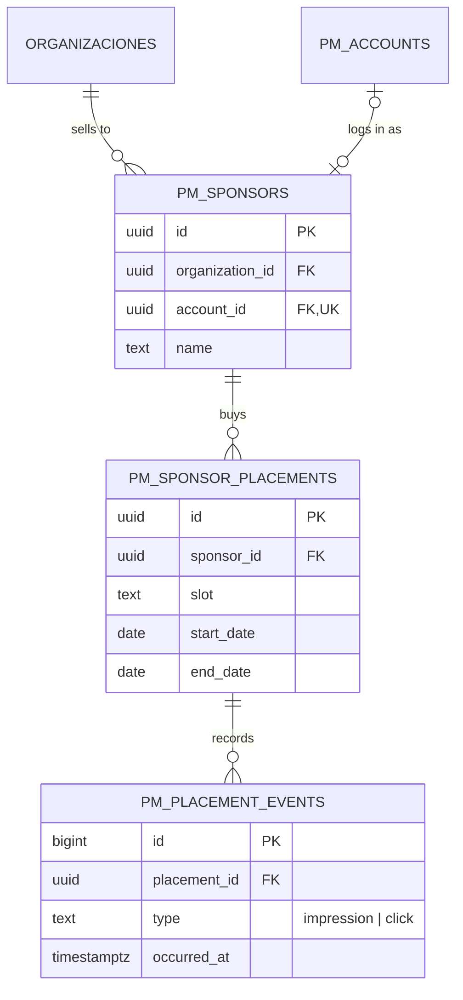
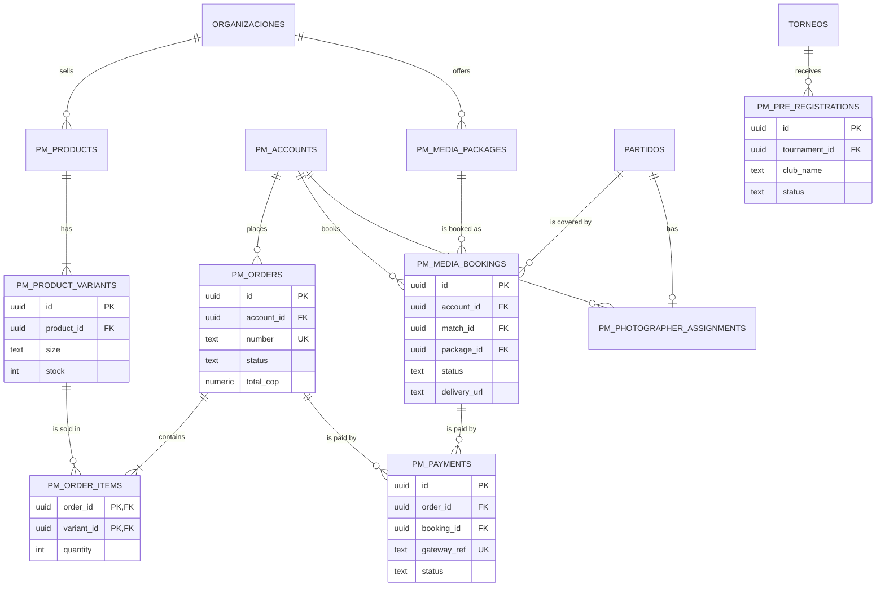

# 4. Relational database model

**Engine:** PostgreSQL (Supabase), the same database as the tournament-management platform.

The model has two parts:

1. **Consumed (read-only).** These are the existing platform tables (`organizaciones`, `torneos`, `categorias`, `clubes`, `equipos`, `partidos`, `partido_goles`…). The anonymous role never reads them directly. It reads `public_*` views, which return rows only for tournaments with `torneos.publico = true` and expose no personal data (BR-01, BR-06).
2. **Owned.** These are new tables with the `pm_` prefix (Public Module), created through versioned SQL migrations. Every table is anchored to an organization (`organization_id`), and row-level security (RLS) policies isolate organizations and owners (BR-08, BR-15).

## 4.1 ER diagrams: owned tables and their links to the platform

Split into three diagrams for readability. Upper-case Spanish names (`ORGANIZACIONES`, `TORNEOS`, `EQUIPOS`, `PARTIDOS`) are existing platform tables, kept as they are in production. Every column of the owned tables is defined in 4.3.

### a) Public site, accounts, follows and notifications

### b) Sponsorship

### c) Store, photo/video bookings, payments and pre-registrations

## 4.2 Consumed views (read-only, role `anon`)

| View | Columns exposed | Source tables | Filter |
|---|---|---|---|
| `public_schedule` | match_id, tournament_id, category, group, matchday, kickoff, venue, field, home_team, away_team, home_goals, away_goals, public_status | `partidos`, `equipos`, `canchas`, `sedes`, `jornadas` | tournament is public; schedule approved, otherwise `public_status = 'TO_BE_SCHEDULED'` and no field or time |
| `public_match_scorers` | match_id, team_id, player_name, goals | `partido_goles`, `inscripciones`, `participantes` | only the player's name: no ID number, birth date or photo |
| `public_standings` | tournament_id, category, group, team_id, team, position, played, won, drawn, lost, gf, ga, gd, points, has_provisional, withdrawn | view `posiciones` | tournament is public |
| `public_top_scorers` | tournament_id, category, player_name, team, goals, position | view `goleadores` | tournament is public |
| `public_best_defense` | tournament_id, category, team, played, goals_against, position | view `valla_menos_vencida` | tournament is public |
| `public_teams` / `public_clubs` | id, name, slug, logo_url, category, group, club | `equipos`, `clubes`, `grupo_equipos` | tournament is public |
| `public_documents` | id, title, type, published_at, file_url | `documentos_torneo` | document marked public (new flag, BR-07) |

## 4.3 Owned tables

Notation: **PK** primary key, **FK** foreign key, **UK** unique. Every table also has `created_at timestamptz DEFAULT now()`.

### Public site and content

| Table | Columns | Keys and constraints |
|---|---|---|
| `pm_public_sites` | id uuid, organization_id uuid, custom_domain text, logo_url text, primary_color text, secondary_color text, show_news bool, show_gallery bool, show_store bool, show_bookings bool, show_preregistration bool | PK id · FK organization_id → organizaciones(id) · UK organization_id · UK custom_domain |
| `pm_published_tournaments` | site_id uuid, tournament_id uuid, published_at timestamptz | PK (site_id, tournament_id) · FK site_id → pm_public_sites · FK tournament_id → torneos(id) |
| `pm_news_posts` | id uuid, organization_id uuid, title text, body text, cover_url text, tag text, status text, published_at timestamptz, author_id uuid | PK id · FK organization_id → organizaciones · FK author_id → pm_accounts · CHECK status IN ('draft','published') |
| `pm_gallery_photos` | id uuid, post_id uuid, image_url text, caption text, matchday int | PK id · FK post_id → pm_news_posts ON DELETE CASCADE |
| `pm_widgets` | id uuid, organization_id uuid, type text, options jsonb | PK id · FK organization_id → organizaciones · CHECK type IN ('standings','upcoming','results') |

### Accounts, follows and notifications

| Table | Columns | Keys and constraints |
|---|---|---|
| `pm_accounts` | id uuid, organization_id uuid, role text, display_name text, email text | PK id (= auth.users.id) · FK organization_id → organizaciones · CHECK role IN ('fan','organizer','photographer','sponsor') · UK (organization_id, email) |
| `pm_team_follows` | account_id uuid, team_id uuid | PK (account_id, team_id) · FK account_id → pm_accounts ON DELETE CASCADE · FK team_id → equipos(id) |
| `pm_push_subscriptions` | id uuid, account_id uuid, endpoint text, p256dh text, auth text, active bool, last_ok_at timestamptz | PK id · FK account_id → pm_accounts ON DELETE CASCADE · UK endpoint |
| `pm_notifications` | id uuid, account_id uuid, match_id uuid, type text, title text, body text, url text, push_sent_at timestamptz, read_at timestamptz | PK id · FK account_id → pm_accounts · FK match_id → partidos(id) · CHECK type IN ('schedule_published','result_approved','delivery_ready') |

### Sponsorship

| Table | Columns | Keys and constraints |
|---|---|---|
| `pm_sponsors` | id uuid, organization_id uuid, account_id uuid, name text, logo_url text, contact_email text | PK id · FK organization_id → organizaciones · FK account_id → pm_accounts (nullable) · UK account_id |
| `pm_sponsor_placements` | id uuid, sponsor_id uuid, slot text, creative_url text, target_url text, start_date date, end_date date | PK id · FK sponsor_id → pm_sponsors ON DELETE CASCADE · CHECK slot IN ('web_banner','app_banner','matchday_graphic') · CHECK end_date >= start_date |
| `pm_placement_events` | id bigint, placement_id uuid, type text, channel text, occurred_at timestamptz | PK id · FK placement_id → pm_sponsor_placements · CHECK type IN ('impression','click') · no personal data columns (BR-14) |

### Store, bookings and payments

| Table | Columns | Keys and constraints |
|---|---|---|
| `pm_products` | id uuid, organization_id uuid, name text, description text, photo_url text, price_cop numeric(12,0), active bool | PK id · FK organization_id → organizaciones · CHECK price_cop > 0 |
| `pm_product_variants` | id uuid, product_id uuid, size text, stock int | PK id · FK product_id → pm_products ON DELETE CASCADE · UK (product_id, size) · CHECK stock >= 0 (BR-11) |
| `pm_orders` | id uuid, organization_id uuid, account_id uuid, number text, status text, total_cop numeric(12,0) | PK id · FK organization_id, account_id · UK number · CHECK status IN ('pending','paid','ready','delivered','cancelled') |
| `pm_order_items` | order_id uuid, variant_id uuid, quantity int, unit_price_cop numeric(12,0) | PK (order_id, variant_id) · FK order_id → pm_orders ON DELETE CASCADE · FK variant_id → pm_product_variants · CHECK quantity > 0 |
| `pm_media_packages` | id uuid, organization_id uuid, name text, type text, price_cop numeric(12,0), booking_cutoff_hours int, active bool | PK id · FK organization_id · CHECK type IN ('photo','video') |
| `pm_media_bookings` | id uuid, account_id uuid, match_id uuid, package_id uuid, status text, delivery_url text, delivered_at timestamptz | PK id · FK account_id → pm_accounts · FK match_id → partidos(id) · FK package_id → pm_media_packages · CHECK status IN ('pending','paid','delivered','cancelled') · trigger: match must be scheduled and before the cut-off (BR-12) |
| `pm_photographer_assignments` | match_id uuid, photographer_id uuid, assigned_by uuid | PK match_id · FK match_id → partidos(id) · FK photographer_id → pm_accounts (role = photographer) |
| `pm_payments` | id uuid, order_id uuid, booking_id uuid, gateway_ref text, amount_cop numeric(12,0), status text, raw_event jsonb, confirmed_at timestamptz | PK id · FK order_id → pm_orders, booking_id → pm_media_bookings · **UK gateway_ref** (idempotent webhook, BR-10) · CHECK exactly one of order_id / booking_id is not null · CHECK status IN ('pending','approved','rejected') |
| `pm_pre_registrations` | id uuid, tournament_id uuid, club_name text, contact_name text, contact_email text, contact_phone text, categories text[], status text, reason text, reviewed_by uuid | PK id · FK tournament_id → torneos(id) · CHECK status IN ('pending','approved','rejected') · CHECK reason IS NOT NULL when rejected |

## 4.4 Integrity and security rules in the database

- **RLS on every `pm_` table.** A fan reads and writes only rows where `account_id = auth.uid()`. An organizer reads and writes only rows of organizations where they are a member (the existing `es_miembro_org()` helper). A sponsor reads only their own placements and events. The anonymous role reads only published news, active placements, active products and the `public_*` views.
- **Idempotent payments.** The `UK gateway_ref` constraint plus `INSERT … ON CONFLICT DO NOTHING` guarantee that repeated webhooks confirm a payment once.
- **Stock.** It is decremented in the same transaction that marks the payment as approved; `CHECK stock >= 0` aborts overselling.
- **No personal data in public views.** The views select explicit columns (never `*`) and run with `security_invoker` to keep the platform's RLS in force.
