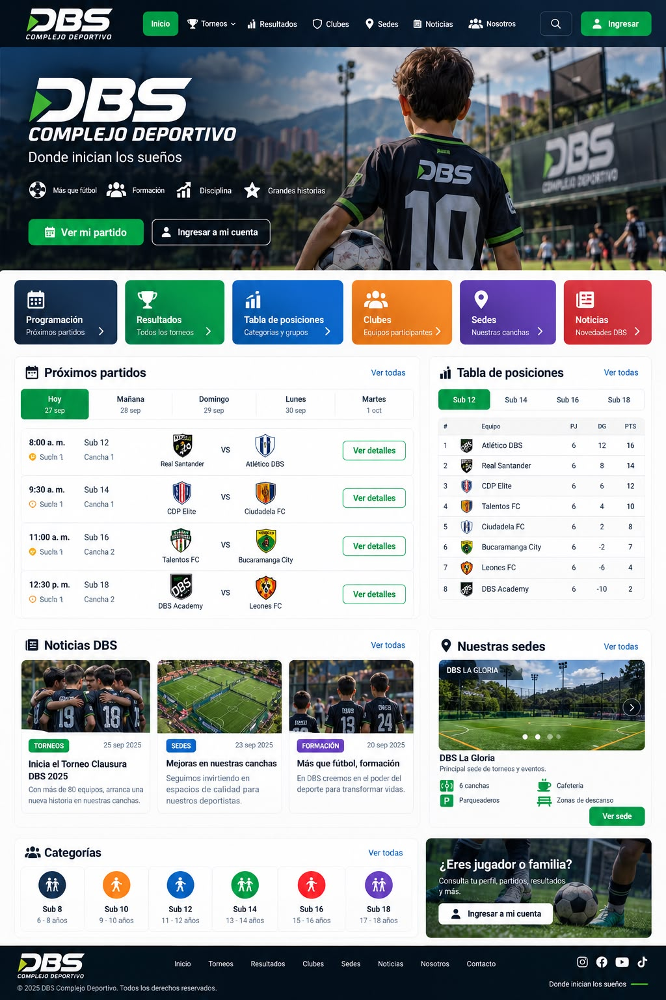

# 5. Mockups

The mockups cover only the **main screens** of the Public Module. They were built as a clickable high-fidelity prototype in **v0 by Vercel**. The prototype started from a v0 template and used the reference image sent by the pilot organization (DBS Complejo Deportivo) as the visual guide. The exact prompt is in [v0-prompt.md](v0-prompt.md).

Public screens are designed **mobile-first** (390 px), because most visitors follow the tournament from a phone at the venue (RNF-07). The organizer and sponsor screens are desktop back-office views (1440 px). All the data shown is fictional; no real player data is used (BR-06).

| # | Screen | Purpose | Stories covered |
|---|---|---|---|
| 0 | Reference sent by the organization | Visual identity the public site must follow (colors, header, tiles, cards). | — |
| 1 | Home (desktop) | Entry point. Shows the brand, quick access to schedule, results, standings, clubs, venues and news, the next matches, a standings preview, the latest news and the sponsors. | HU-01, HU-03, HU-09, HU-20 |
| 2 | Matchday schedule and results (mobile) | Shows each match of the matchday by category and group: time, field, teams, score and scorers, including the "Provisional" and "To be scheduled" states. Offers to install the app. | HU-01, HU-02, HU-06 |
| 3 | Standings (mobile) | Group table with tie-breaks, provisional flag and withdrawn teams, plus the top scorers and best defense tabs. | HU-03, HU-04 |
| 4 | Team profile (mobile) | One page per team: crest, club, category, group, position, upcoming matches, results and the "Follow" button. | HU-07, HU-08, HU-13 |
| 5 | My teams (mobile, signed-in fan) | The fan's home page: next match and last result of each followed team, notifications and push settings. | HU-12, HU-13, HU-14 |
| 6 | Book photo/video (mobile) | Lets a fan book a photo or video package for a scheduled match and pay through the payment gateway. | HU-16, HU-17 |
| 7 | Organizer: public site (desktop) | Back-office where the organizer sets the brand (logo, colors, domain), the published tournaments and the visible sections. | HU-19, HU-20, HU-24 |
| 8 | Sponsor dashboard (desktop) | Impressions, clicks and CTR of the sponsor's own placements by period, with a downloadable report. | HU-33, HU-34 |

## 5.0 Reference sent by the organization

## 5.1 Home

## 5.2 Matchday schedule and results

## 5.3 Standings

## 5.4 Team profile

## 5.5 My teams

## 5.6 Book photo/video

## 5.7 Organizer: public site

## 5.8 Sponsor dashboard

