# 5. Mockups

The mockups cover only the **main screens** of the Public Module. They were built as a clickable high-fidelity prototype in **v0 by Vercel**. The prototype started from a v0 template and used the reference image sent by the pilot organization (DBS Complejo Deportivo) as the visual guide. The exact prompt is in [v0-prompt.md](v0-prompt.md).

The prototype was requested mobile-first and responsive (RNF-07); the captures below were taken at desktop width. All the data shown is fictional (teams, players, scores and metrics); no real player data is used (BR-06).

| # | Screen | Purpose | Requirements covered |
|---|---|---|---|
| 0 | Reference sent by the organization | Visual identity the public site must follow: dark header, green actions, coloured quick-access tiles, rounded cards. It also defines the home page layout. | — |
| 1 | Home | Entry point, shown in two captures because the page is long: upcoming matches, latest news, the venue, categories, a sign-in banner for players and families, and the **official sponsors** strip (a sponsor placement, BR-14). The top of the page (hero and quick-access tiles) follows the reference image. | HU-01, HU-09, HU-12, RF-19 |
| 2 | Schedule and results | Lists the matches of the tournament by category and group, with date, time, field and teams. A match without an approved schedule shows **"To be scheduled"** and no time or field (BR-02). The *Results* toggle shows approved scores. | HU-01, HU-02 |
| 3 | Standings | Group tables with P, W, D, L, GF, GA, GD and points. A yellow dot marks teams with **provisional** results (BR-03) and a withdrawn team goes to the bottom, crossed out (BR-04). Tabs give the top scorers and best defense. | HU-03, HU-04 |
| 4 | Team profile | One page per team: crest, category, group, position, points, record, upcoming matches and results with scorers (name and team only, BR-06). The **"Follow team"** button starts the fan flow. | HU-07, HU-13 |
| 5 | Club profile | All the teams of a club in the tournament, one per category, with their group, position and points. | HU-08 |
| 6 | News | News published by the organization, newest first, filtered by topic. | HU-09 |
| 7 | Venues | The organization's venue with address, number of fields and amenities, so families know where each match is played. | RF-01 (field of each match) |
| 8 | My teams | The fan's home. Without a session it asks the visitor to sign in, because following teams and receiving notifications require a fan account (BR-08). | HU-12, HU-13, HU-14 |
| 9 | Book photo or video | The fan chooses a package (photo pack or video highlights, prices in COP), picks a scheduled match (BR-12) and requests the booking, which is then paid through the payment gateway (BR-10). | HU-16 |
| 10 | Sponsorship dashboard | Impressions, clicks and CTR by placement (website, app, match graphics) over the last 60 days, with daily trend. The capture shows the organizer's aggregated view; a sponsor account sees only its own placements (BR-14). | HU-26, HU-33 |

## 5.0 Reference sent by the organization

## 5.1 Home

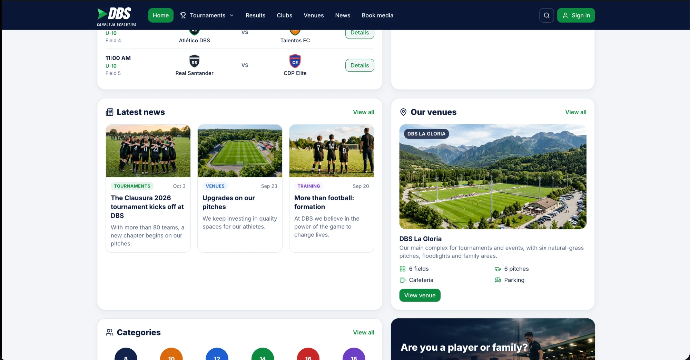

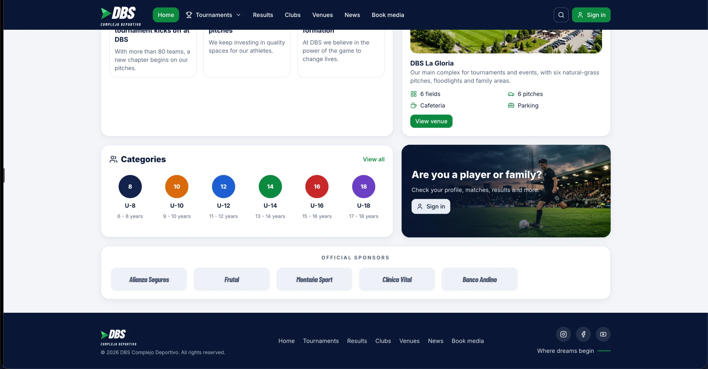

## 5.2 Schedule and results

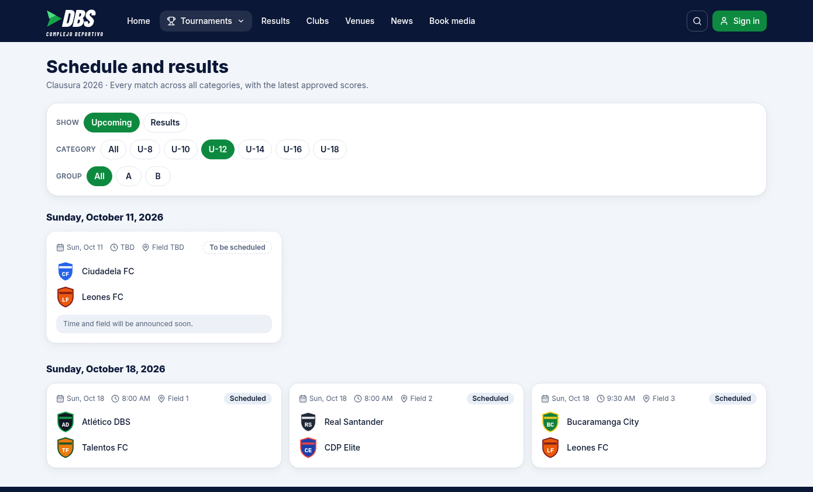

## 5.3 Standings

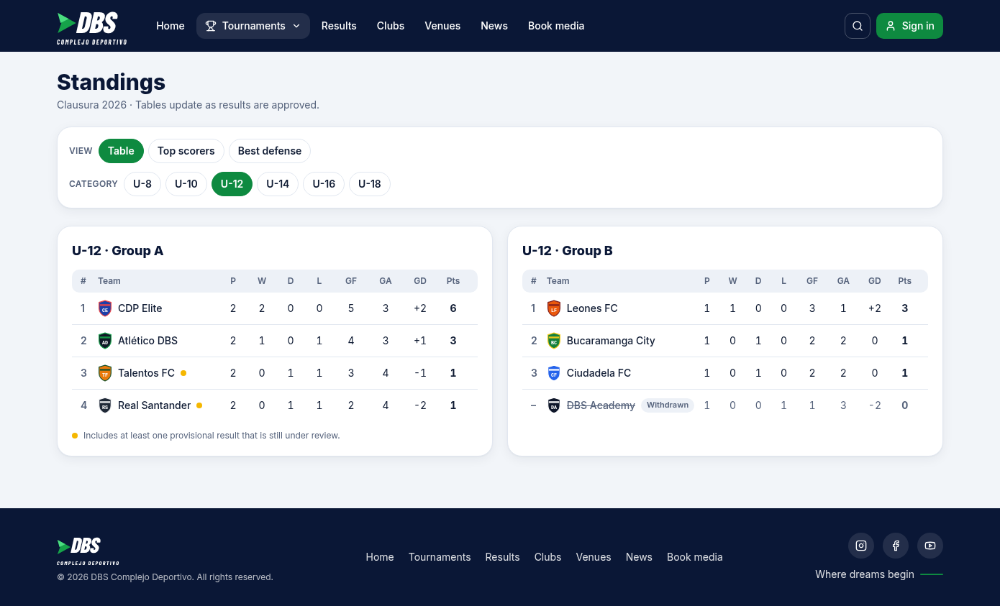

## 5.4 Team profile

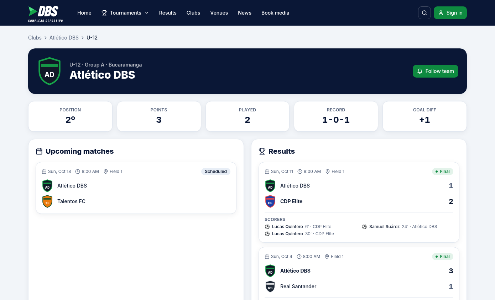

## 5.5 Club profile

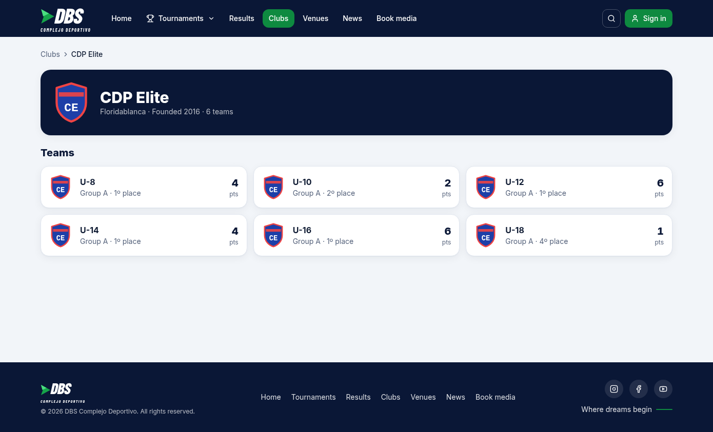

## 5.6 News

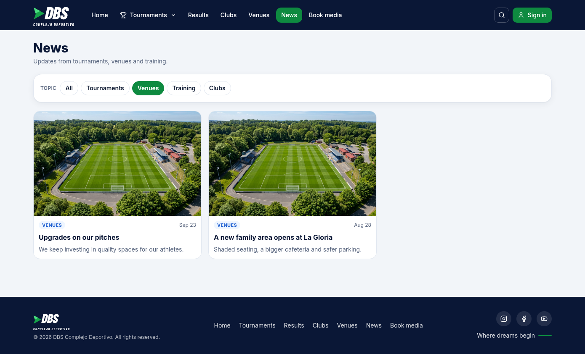

## 5.7 Venues

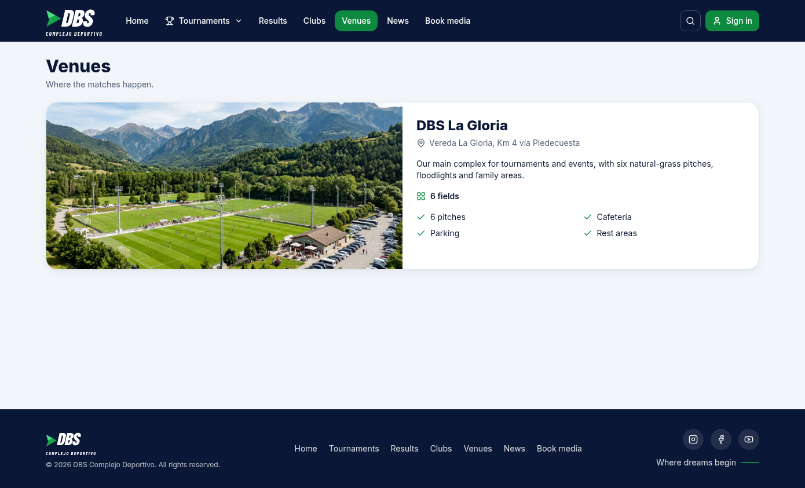

## 5.8 My teams

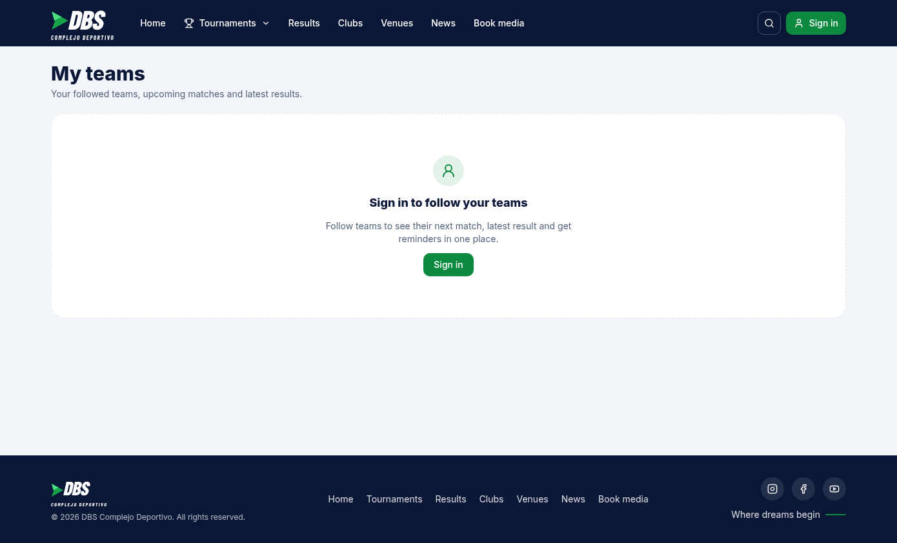

## 5.9 Book photo or video

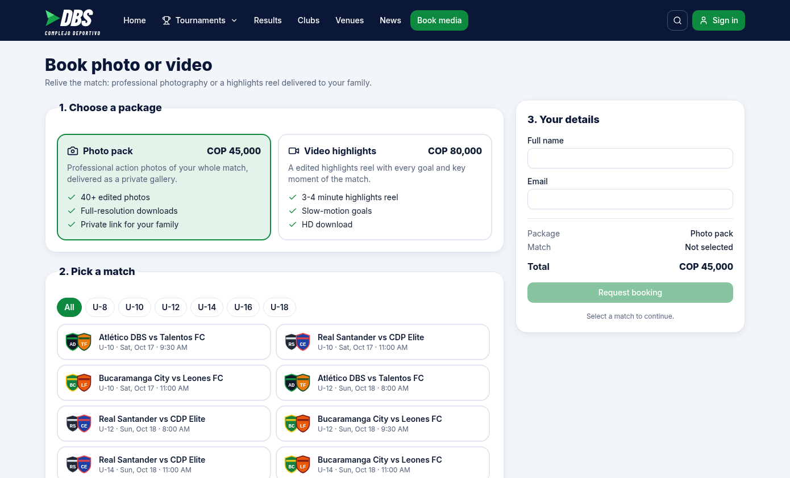

## 5.10 Sponsorship dashboard

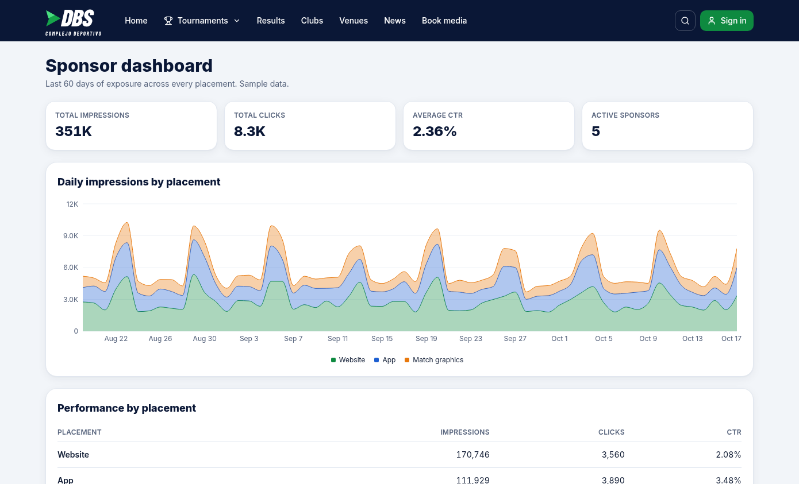
