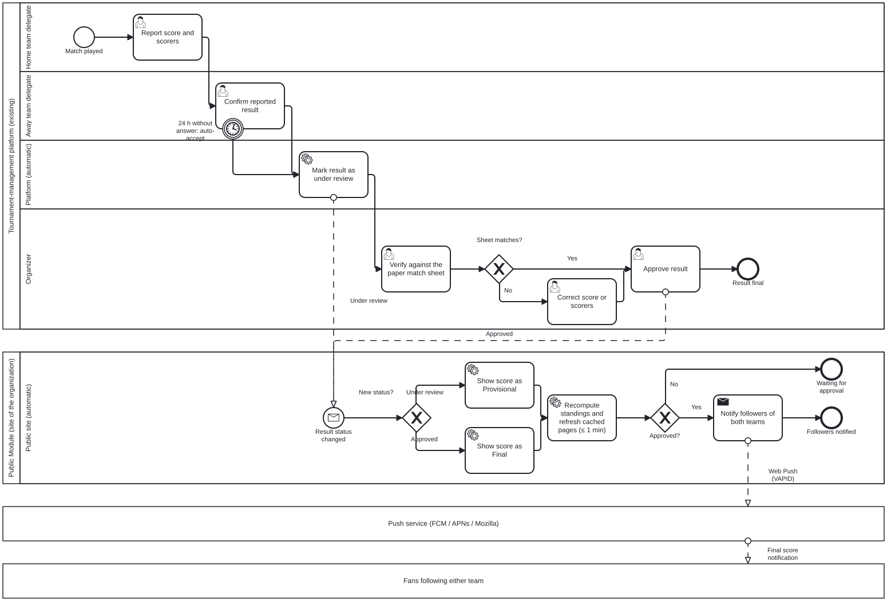
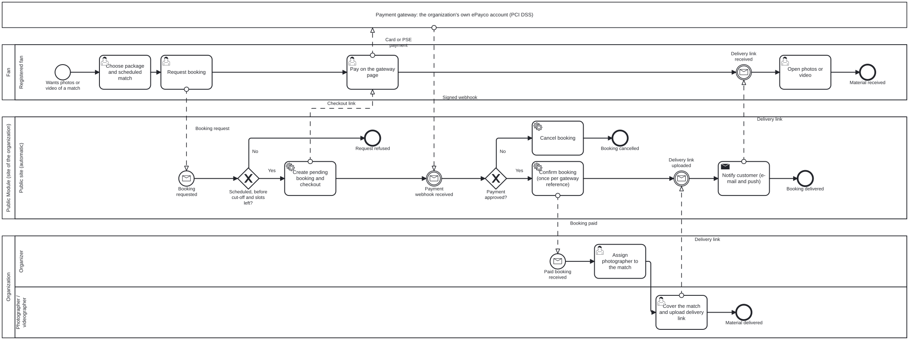

# 6. Business process models

Two business processes are documented in **BPMN 2.0**. P1 is the core process of the Public Module: it is the reason families open the site every match day. P2 is the main commercial process. Each diagram has its editable source (`.bpmn`, opens in [bpmn.io](https://demo.bpmn.io) or Camunda Modeler) in the [bpmn/](bpmn/) folder.

**Notation used:** pools are participants and lanes are roles inside a participant. Solid arrows are sequence flows inside one participant; dashed arrows are messages between participants. Diamonds with an X are exclusive gateways (one branch only). The clock on a task is a timer boundary event, and envelopes are message events. A collapsed pool (a plain bar) is an external participant whose internal process is not modeled.

## 6.1 P1 — Publish an approved result and notify followers *(core process)*

**Description.** After a match, the home team delegate reports the score and the scorers in the management platform. The away team delegate confirms it; if they do not answer within 24 hours, the platform accepts it automatically. The result is then **under review**. The organizer verifies it against the paper match sheet signed by the referee, corrects it if needed and approves it.

Each status change reaches the Public Module as a message (*Result status changed*):

- **Under review:** the site shows the score as **"Provisional"**, and it already counts in the standings.
- **Approved:** the site shows it as **"Final"**, recomputes standings, top scorers and best defense, refreshes the cached pages in less than one minute and sends a push notification to every fan who follows either team.

| Item | Detail |
|---|---|
| Trigger | A match is played. |
| Participants | Home and away team delegates, platform automation and organizer (management platform); Public Module; push service; fans. |
| Outcome | The final score is public, the standings are up to date and followers are notified. |
| Business rules applied | BR-03 (provisional vs. final), BR-04 (standings and tie-breaks), BR-05 (scorers), BR-06 (no personal data: scorers by name and team only), BR-09 (only followers of the team are notified). |
| Requirements | RF-02, RF-03, RF-04, RF-18; HU-02, HU-03, HU-04, HU-14; RNF-02 (visible in ≤ 1 minute), RNF-03 (served from cache). |
| Role in the application | It is the **main reason to visit** the public site and the app on match days. It connects the two systems: the management platform **owns** the result and its approval, and the Public Module **publishes** it and **notifies** fans. It never writes competition data (see section 1.1). |

## 6.2 P2 — Book and deliver a photo or video package *(commercial process)*

**Description.** A registered fan chooses a package (photo pack or video highlights) and a scheduled match, and requests the booking. The Public Module checks that the match is scheduled and that the booking cut-off has not passed. It then creates a **pending** booking and sends the fan to the payment gateway's checkout. The gateway reports the outcome through a **signed webhook**:

- **Rejected payment:** the booking is cancelled.
- **Approved payment:** the booking is confirmed **once per gateway reference**, even if the webhook arrives several times, and the organizer receives it.

The organizer assigns a photographer to the match; one photographer covers all the bookings of that match. After the match the photographer uploads the delivery link. The Public Module then notifies the customer by e-mail and push, and the fan opens the material.

| Item | Detail |
|---|---|
| Trigger | A fan wants photos or a video of a match. |
| Participants | Fan; Public Module; payment gateway (ePayco); organization (organizer and photographer). |
| Outcome | The fan receives a private link to the material, and the organization collects the payment. |
| Business rules applied | BR-10 (confirmed only when the payment is approved, idempotent webhook, no card data), BR-12 (scheduled match, before the cut-off, photographer per match), BR-13 (link visible only to the paying customer, notified by e-mail and push). |
| Requirements | RF-25, RF-26, RF-27; HU-16, HU-17, HU-29, HU-31, HU-32; RNF-05 (each account sees only its own data), RNF-06 (PCI DSS gateway). |
| Role in the application | It is one of the **revenue sources** of the commercial release (R4) and the template for the store checkout (RF-23), which follows the same pending → paid → delivered pattern with the same idempotent payment confirmation. |

## 6.3 Mapping to the design

| Process step | Where it lives in the design |
|---|---|
| Result status, provisional/final | `Match.publicStatus()` (class diagram 3.1), view `public_schedule` (4.2) |
| Recompute standings | view `public_standings` over `posiciones` (4.2) |
| Notify followers | `TeamFollow`, `Notification`, `PushSubscription` (3.2); `pm_team_follows`, `pm_notifications`, `pm_push_subscriptions` (4.3) |
| Pending booking, checkout, webhook | `MediaBooking`, `Payment`, `PaymentGateway` (3.3); `pm_media_bookings`, `pm_payments` with `UK gateway_ref` (4.3) |
| Assign photographer, upload link | `PhotographerAssignment` (3.3); `pm_photographer_assignments` (4.3) |
