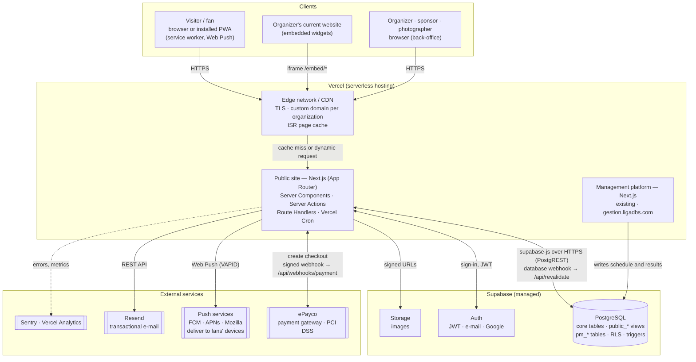
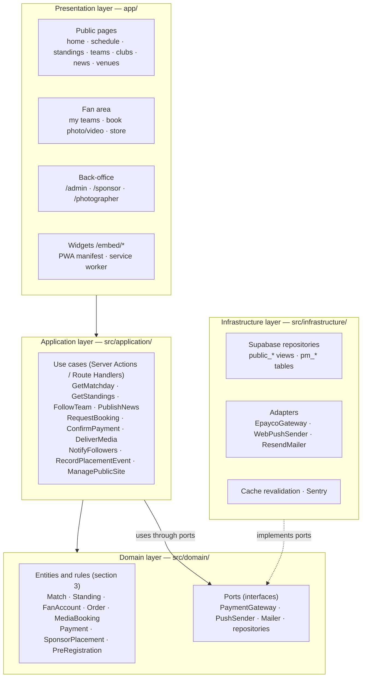
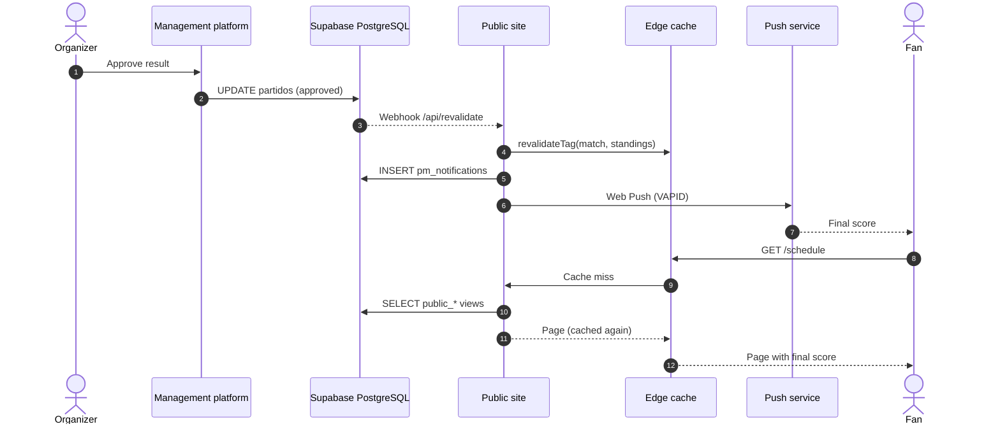
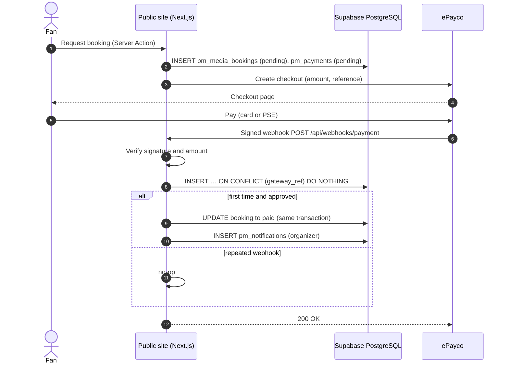

# 7. Architecture

The Public Module is a **new web application** next to the tournament-management platform that is already in production. The two applications share **one PostgreSQL database** (Supabase). The management platform writes the competition data; the public site reads it through the `public_*` views and owns its `pm_*` tables (section 4). Inside the public site the code follows the **layered architecture** of Domain-Driven Design: presentation, application, domain and infrastructure.

## 7.1 Architectural decisions

| ID | Decision | Reason | Alternative discarded |
|---|---|---|---|
| AD-01 | **Two deployable applications, one database.** The management platform (`gestion.ligadbs.com`) and the public site (`ligadbs.com`) are separate Next.js projects on Vercel that share one Supabase project. | Match-day traffic on the public site (2,000 simultaneous visitors, RNF-03) must not slow down the organizer's panel. Sharing the database avoids copying or syncing data between systems. | **Microservices**: too much operational cost for a five-person team with a single database. **One single application**: it would mix anonymous public traffic with staff panels and their deployments. |
| AD-02 | **Layered architecture** inside the public site (presentation → application → domain ← infrastructure). | The rules (provisional vs. final, booking cut-off, idempotent payments) stay in plain TypeScript, testable without a database or a browser. | Business logic spread across pages and components. |
| AD-03 | **The public side reads views, never base tables.** The anonymous role only reads `public_*` views filtered by `torneos.publico`. | No personal data of players can leak (BR-06), and non-public tournaments return nothing (BR-01). | Reading the platform's tables and filtering in code. |
| AD-04 | **Cache first.** Pages are rendered on the server and cached at Vercel's edge (Incremental Static Regeneration). A database webhook revalidates the affected pages when a schedule or result changes, with a 60-second fallback. | Most visits never reach the database (RNF-03), pages load fast on 4G (RNF-01) and an approved result is visible in under one minute (RNF-02). | Querying the database on every visit. |
| AD-05 | **Security lives in the database.** Supabase Auth (e-mail or Google, JWT) plus row-level security on every `pm_` table. Secret keys only on the server. | A fan, sponsor or photographer can only reach their own rows even if the interface has a bug (RNF-05). | Checking permissions only in the UI. |
| AD-06 | **Ports and adapters** for external services: `PaymentGateway` (ePayco), `PushSender` (Web Push) and `Mailer` (Resend). | The provider can change without touching the use cases (SOLID: dependency inversion). Tests use fake adapters. | Calling the providers' SDKs from the use cases. |
| AD-07 | **Outbox for notifications.** Notifications are first stored in `pm_notifications`, sent right away and retried by a scheduled job (Vercel Cron). | A failed push or e-mail is not lost, and a slow provider does not block the request. The same pattern already runs in the management platform. | Sending inside the request with no retry. |
| AD-08 | **Multi-tenant by configuration.** The request host identifies the organization; brand and sections come from `pm_public_sites`. | A new league is enabled without code changes or deployments (RNF-11). | One deployment per organization. |
| AD-09 | **Widgets as embeddable pages** (`/embed/standings`, `/embed/upcoming`, `/embed/results`) loaded in an iframe. | The organizer pastes one line of HTML on their current website; widgets reuse the same cached pages and need no login. | A JavaScript SDK that each website must integrate. |

## 7.2 Container and deployment diagram

Solid arrows are synchronous calls over HTTPS; the label says what travels. Double arrows are request and answer in both directions.

| Component | Technology | Responsibility |
|---|---|---|
| Public site | Next.js (App Router), React, TypeScript, Tailwind CSS, shadcn/ui | Public pages, PWA, widgets, fan area, back-office for organizer, sponsor and photographer |
| PWA | Web App Manifest, service worker, Web Push (`web-push`, VAPID) | Installation on Android and iOS, push notifications, offline shell |
| Edge / CDN | Vercel Edge Network, Incremental Static Regeneration | TLS, custom domain per organization, cached pages |
| Server logic | Route Handlers, Server Actions and Cron on Vercel Functions (Node.js), Zod validation | Use cases, payment webhook, revalidation, notification dispatch |
| Database | Supabase PostgreSQL with RLS, views, triggers and versioned SQL migrations | Single source of truth; isolation by organization and by owner |
| Auth and storage | Supabase Auth (JWT, e-mail and Google OAuth), Supabase Storage | Accounts of fans, organizers, sponsors and photographers; images |
| External services | ePayco, Resend (with React Email), browser push services | Payments, transactional e-mail, notifications |
| Observability and delivery | Sentry, Vercel Analytics, GitHub, Vercel preview deployments, Vitest, Playwright | Errors and performance; one preview per branch; unit and end-to-end tests |

## 7.3 Layered view of the public site

**Dependency rule:** each layer only depends on the layer below it, and the domain depends on nothing. Infrastructure implements the domain's ports, so Supabase, ePayco, Web Push and Resend are interchangeable details. The domain classes are the ones of the class diagram (section 3) and the repositories map them to the tables and views of section 4.

## 7.4 Main communication flows

### a) An approved result reaches the public site (technical view of process P1)

### b) Idempotent payment confirmation (technical view of process P2)

## 7.5 How the architecture meets the non-functional requirements

| Requirement | How it is met |
|---|---|
| RNF-01 Performance (< 2.5 s on 4G) | Server-rendered pages served from the edge cache; images optimized by Next.js |
| RNF-02 Data freshness (≤ 1 min) | Database webhook triggers on-demand revalidation; 60-second fallback (AD-04) |
| RNF-03 Scalability (2,000 visitors) | Cache-first public pages; separate deployable from the organizer's panel (AD-01) |
| RNF-04 Privacy | Public side reads only `public_*` views with explicit columns (AD-03) |
| RNF-05 Security | Supabase Auth + RLS on every `pm_` table; secrets only on the server (AD-05) |
| RNF-06 Payment security | PCI DSS gateway; signature check; idempotent confirmation by `gateway_ref`; no card data stored |
| RNF-07 / RNF-08 Usability and accessibility | Mobile-first responsive UI with accessible components (shadcn/ui on Radix primitives) |
| RNF-09 Availability (99.5 %) | Managed serverless hosting and database; cached pages keep working during short database incidents |
| RNF-10 Compatibility | Standard PWA (manifest, service worker, Web Push) supported on Android 10+ and iOS 16.4+ |
| RNF-11 Maintainability (new league by configuration) | Host-to-organization resolution and branding from `pm_public_sites` (AD-08) |
| RNF-12 Search visibility | Server-rendered pages with their own URL and Open Graph metadata per team, match and news item |
