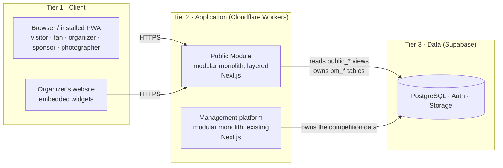
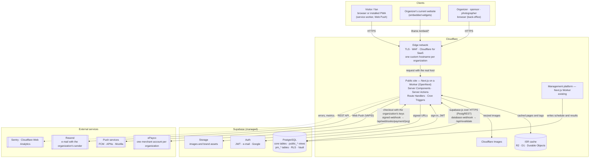
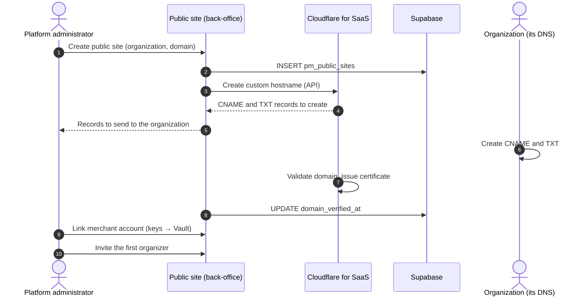
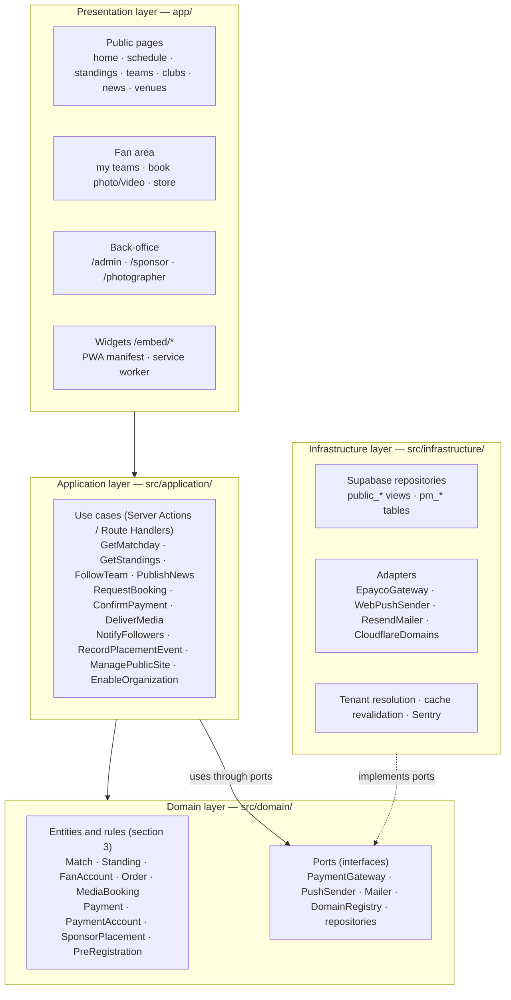
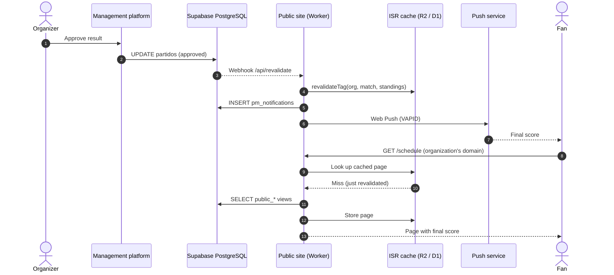
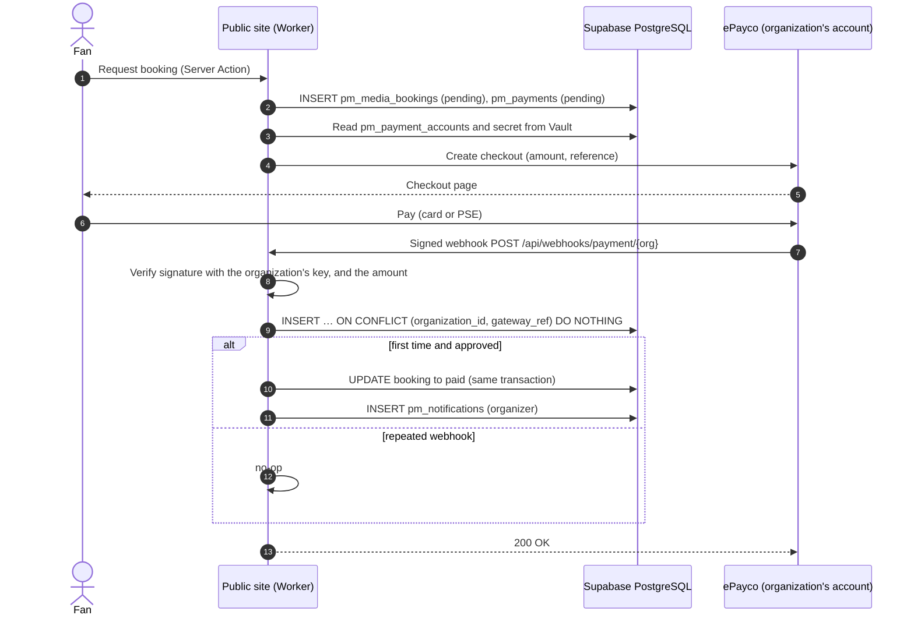

# 7. Architecture

## 7.1 Architectural style

**The Public Module uses a client–server architecture in three tiers, and its server side is a modular monolith organized in layers.** It is deployed on serverless infrastructure: Cloudflare runs the application and Supabase provides the database. It is **not** a microservices architecture.

- **Client tier.** The browser or the installed PWA renders the pages and keeps the service worker that receives push notifications. Widgets run inside an iframe on the organization's current website.
- **Application tier.** One Next.js application, deployed as a single unit, holds all the server logic of the Public Module: pages, use cases, payment webhook, notifications and back-office. Inside, it is split into layers (presentation, application, domain and infrastructure, section 7.5) and into modules by subject (results, fans, sponsorship, store, bookings).
- **Data tier.** One PostgreSQL database (Supabase), shared with the management platform. Each application owns its tables: the management platform writes the competition data, and the Public Module reads it through the `public_*` views and owns the `pm_*` tables (section 4).

The management platform follows the same style. The system as a whole is therefore **two monoliths that share one database**, each one with its own deployment.

**Why this style and not the others** (styles seen in the course):

| Style | Fits? | Reason |
|---|---|---|
| **Client–server, three tiers** | **Yes, it is the base** | Thousands of clients (phones) request pages and data from a central server that holds the rules and the single source of truth. Clients never talk to each other or to the database directly. |
| **Monolithic (modular, layered)** | **Yes, for each application** | One team of five, one database and one release cycle. A single deployable per application is simpler to build, test and operate. Splitting it into modules and layers keeps it maintainable (SOLID, DDD). |
| Microservices | No | The services would share one database and one team, so they would not be independent. A network call between every module adds latency, failure points and operating cost that this project does not need. Section 7.2 (AD-01) records this decision. |
| Peer-to-peer | No | There is no exchange between clients; all data comes from the organization and the management platform. |

## 7.2 Architectural decisions

| ID | Decision | Reason | Alternative discarded |
|---|---|---|---|
| AD-01 | **Two deployable applications, one database.** The management platform and the public site are two separate Next.js applications, each one a Cloudflare Worker in the same account, that share one Supabase project. | Match-day traffic on the public site (2,000 simultaneous visitors, RNF-03) must not slow down the organizer's panel. Sharing the database avoids copying or syncing data between systems. | **Microservices**: too much operational cost for a five-person team with a single database. **One single application**: it would mix anonymous public traffic with staff panels and their deployments. |
| AD-02 | **Layered architecture** inside the public site (presentation → application → domain ← infrastructure). | The rules (provisional vs. final, booking cut-off, capacity, idempotent payments) stay in plain TypeScript, testable without a database or a browser. | Business logic spread across pages and components. |
| AD-03 | **The public side reads views, never base tables.** The anonymous role only reads `public_*` views filtered by `torneos.publico`. | No personal data of players can leak (BR-06), and non-public tournaments return nothing (BR-01). | Reading the platform's tables and filtering in code. |
| AD-04 | **Cache first.** Pages are rendered on the server and cached with Incremental Static Regeneration, which the OpenNext adapter stores in Cloudflare: page cache in **R2**, tags in **D1** and the revalidation queue in **Durable Objects**. A Supabase **database webhook** calls `/api/revalidate` when a schedule or result changes, with a 60-second fallback. | Most visits never reach the database (RNF-03), pages load fast on 4G (RNF-01) and an approved result is visible in under one minute (RNF-02). | Querying the database on every visit. |
| AD-05 | **Security lives in the database.** Supabase Auth (e-mail or Google, JWT) plus row-level security on every `pm_` table. Secret keys only on the server; the merchant secret of each organization in Supabase Vault. | A fan, sponsor or photographer can only reach their own rows, and an organization only its own, even if the interface has a bug (RNF-05). | Checking permissions only in the UI. |
| AD-06 | **Ports and adapters** for external services: `PaymentGateway` (ePayco), `PushSender` (Web Push) and `Mailer` (Resend). | The provider can change without touching the use cases (SOLID: dependency inversion). Tests use fake adapters, and if a Node library does not run on Workers, only its adapter changes. | Calling the providers' SDKs from the use cases. |
| AD-07 | **Outbox for notifications.** Notifications are first stored in `pm_notifications`, sent right away and retried by a scheduled job (Cloudflare **Cron Triggers**). | A failed push or e-mail is not lost, and a slow provider does not block the request. The same pattern already runs in the management platform. | Sending inside the request with no retry. |
| AD-08 | **Multi-organization and white-label by configuration.** One deployment serves every organization. The request host identifies the organization, and each organization's domain is a custom hostname in **Cloudflare for SaaS**. Section 7.4 details it. | A new league is enabled without code changes or deployments (RNF-11), and each one keeps its own brand, domain, accounts and money (BR-15, BR-24, BR-25). | One deployment or one database per organization. |
| AD-09 | **Widgets as embeddable pages** (`/embed/standings`, `/embed/upcoming`, `/embed/results`) loaded in an iframe; only these routes allow framing (`frame-ancestors`). | The organizer pastes one line of HTML on their current website; widgets reuse the same cached pages and need no login. | A JavaScript SDK that each website must integrate. |
| AD-10 | **Run close to the database.** The Worker uses a placement hint next to Supabase's region (`us-east-1`); static files still come from the nearest Cloudflare location. | Each dynamic page makes several database queries; running the code next to the database avoids paying the Bogotá–Virginia round trip on each one. | Running the code in the edge location closest to the visitor. |

## 7.3 Container and deployment diagram

Solid arrows are synchronous calls over HTTPS; the label says what travels. Double arrows are request and answer in both directions.

| Component | Technology | Responsibility |
|---|---|---|
| Public site | Next.js 15 or later (App Router), React, TypeScript, Tailwind CSS, shadcn/ui; deployed with the OpenNext adapter for Cloudflare | Public pages, PWA, widgets, fan area, back-office for organizer, sponsor and photographer |
| PWA | Web App Manifest and icons per organization, service worker, Web Push (VAPID) | Installation on Android and iOS with the organization's brand, push notifications, offline shell |
| Edge network | Cloudflare (TLS, WAF and rate limiting, Cloudflare for SaaS custom hostnames) | One domain and certificate per organization, protection against abuse |
| Server logic | Route Handlers, Server Actions and Cron Triggers on Cloudflare Workers (`nodejs_compat`), Zod validation | Use cases, payment webhook, revalidation, notification dispatch |
| Page cache | OpenNext incremental cache on R2, tag cache on D1, revalidation queue on Durable Objects | Cached pages per organization; on-demand revalidation |
| Database | Supabase PostgreSQL with RLS, views, triggers, Vault and versioned SQL migrations | Single source of truth; isolation by organization and by owner |
| Auth and storage | Supabase Auth (JWT, e-mail and Google OAuth, redirect URL per domain), Supabase Storage | Accounts per organization; images and brand assets |
| External services | ePayco (one merchant account per organization), Resend (with React Email), browser push services | Payments, transactional e-mail, notifications |
| Observability and delivery | Sentry, Cloudflare Web Analytics, Workers Logs, GitHub, Workers Builds (one preview version per branch), Vitest, Playwright | Errors and performance; previews; unit and end-to-end tests |

## 7.4 Multi-organization (white-label) design

The management platform is already multi-organization: every tournament belongs to an organization (`torneos.id_organizacion`), RLS isolates organizations by membership, and each organization has its own domain and brand. The Public Module follows the same model in every layer:

| Concern | How each organization is kept apart |
|---|---|
| **Data** | Every `pm_` row belongs to one organization, directly or through its parent, and RLS checks it (section 4.4). The domain never grants access. |
| **Domain and certificate** | `pm_public_sites.custom_domain` is registered as a custom hostname in Cloudflare for SaaS. The organization creates a CNAME and a TXT record and Cloudflare issues the certificate. A root domain such as `ligadbs.com` needs a DNS provider with CNAME flattening, or the site lives on `www` and the root redirects. |
| **Tenant resolution** | The middleware reads the host from the request itself (never from a header the client can forge, such as `x-forwarded-host`) and finds the organization. The result is kept for 5 minutes in Cloudflare's Cache API. |
| **Page cache** | The middleware rewrites each request internally to `/{organization}/…`. Cached pages and revalidation tags therefore include the organization, and one league's standings can never be served on another league's domain. |
| **Brand** | Name, logo, colors and background come from `organizaciones`, with optional overrides in `pm_public_sites`. The PWA manifest, icons, Open Graph images, widgets and e-mails are generated with that brand. |
| **Accounts and sessions** | One sign-in identity can have one account per organization (BR-25). Session cookies belong to the domain, so signing in on one league does not sign the person in on another. Supabase Auth lists each organization's domain as an allowed redirect URL. |
| **Push notifications** | The service worker and its push subscriptions belong to the organization's domain and to the account in that organization. |
| **Payments** | Each organization has its own merchant account (`pm_payment_accounts`). The checkout uses its keys, and the webhook route carries the organization, so the signature is checked with the right secret (BR-24). |
| **E-mail** | Sender name and address come from the organization (`organizaciones.email_remitente`). |

**Enabling a new organization** takes no code change and no deployment:

## 7.5 Layered view of the public site

**Dependency rule:** each layer only depends on the layer below it, and the domain depends on nothing. Infrastructure implements the domain's ports, so Supabase, ePayco, Web Push, Resend and Cloudflare are interchangeable details. The domain classes are the ones of the class diagram (section 3) and the repositories map them to the tables and views of section 4.

## 7.6 Main communication flows

### a) An approved result reaches the public site (technical view of process P1)

### b) Idempotent payment confirmation (technical view of process P2)

## 7.7 How the architecture meets the non-functional requirements

| Requirement | How it is met |
|---|---|
| RNF-01 Performance (< 2.5 s on 4G) | Server-rendered pages served from the cache; images resized by Cloudflare Images; code placed next to the database (AD-10) |
| RNF-02 Data freshness (≤ 1 min) | Database webhook triggers on-demand revalidation; 60-second fallback (AD-04) |
| RNF-03 Scalability (2,000 visitors) | Cache-first public pages served without running Next.js on each visit; separate deployable from the organizer's panel (AD-01) |
| RNF-04 Privacy | Public side reads only `public_*` views with explicit columns (AD-03) |
| RNF-05 Security | Supabase Auth + RLS on every `pm_` table, scoped by organization; secrets only on the server and in Vault (AD-05) |
| RNF-06 Payment security | PCI DSS gateway; one merchant account per organization; signature check; idempotent confirmation by `(organization_id, gateway_ref)`; no card data stored |
| RNF-07 / RNF-08 Usability and accessibility | Mobile-first responsive UI with accessible components (shadcn/ui on Radix primitives) |
| RNF-09 Availability (99.5 %) | Managed serverless hosting and database; cached pages stored in R2 keep answering during short database incidents |
| RNF-10 Compatibility | Standard PWA (manifest, service worker, Web Push) supported on Android 10+ and iOS 16.4+ |
| RNF-11 Maintainability (new league by configuration) | One deployment for every organization; custom hostname by API and brand from the database (AD-08, section 7.4) |
| RNF-12 Search visibility | Server-rendered pages with their own URL and Open Graph metadata per team, match and news item, with the organization's brand |
